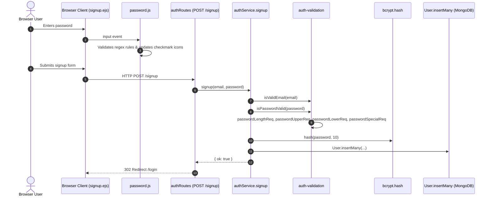
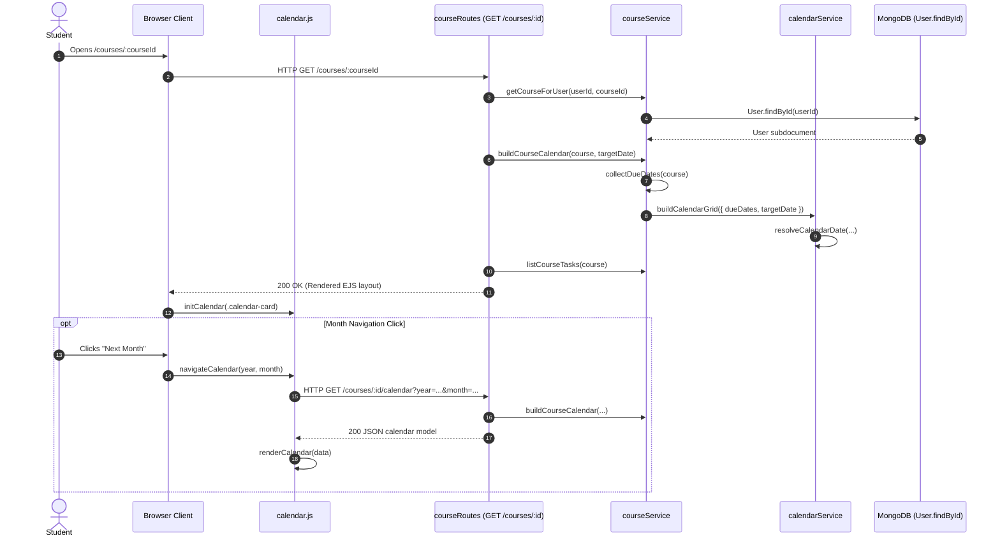

# Function Directory — GradeStar

This directory catalogs all backend and client-side JavaScript functions, route handlers, middleware, and event callbacks across the GradeStar codebase. For each function, this document details its primary purpose, where it is invoked from (callers), and what other functions it invokes (callees).

---

## Table of Contents

- [Quick Reference Master Index](#quick-reference-master-index)
- [1. Server Core & Configuration](#1-server-core--configuration)
- [2. Express Middleware Pipeline](#2-express-middleware-pipeline)
- [3. Authentication Subsystem (Backend)](#3-authentication-subsystem-backend)
- [4. Course Management Subsystem (Backend)](#4-course-management-subsystem-backend)
- [5. Universal Calendar Engine Subsystem (Backend)](#5-universal-calendar-engine-subsystem-backend)
- [6. Client-Side Authentication Scripts](#6-client-side-authentication-scripts)
- [7. Client-Side Course & Popup Scripts](#7-client-side-course--popup-scripts)
- [8. Client-Side Shared UI & Navigation Scripts](#8-client-side-shared-ui--navigation-scripts)
- [9. End-to-End Call Graph Diagrams](#9-end-to-end-call-graph-diagrams)
- [10. Inverted Caller Index](#10-inverted-caller-index)
- [Modular Domain References](#modular-domain-references)

---

## Quick Reference Master Index

| Function / Handler | Defined In | Purpose (Brief) | Called From | Calls |
| :--- | :--- | :--- | :--- | :--- |
| [`start`](file:///Users/anthonyfuca/Desktop/Programming/GradeStar/src/app.js#L38-L45) | [src/app.js](file:///Users/anthonyfuca/Desktop/Programming/GradeStar/src/app.js) | Bootstraps database connection and starts Express HTTP server. | [src/app.js#L47](file:///Users/anthonyfuca/Desktop/Programming/GradeStar/src/app.js#L47) | [`connectDB`](file:///Users/anthonyfuca/Desktop/Programming/GradeStar/src/config/database.js#L3-L11), `app.listen` |
| [`connectDB`](file:///Users/anthonyfuca/Desktop/Programming/GradeStar/src/config/database.js#L3-L11) | [src/config/database.js](file:///Users/anthonyfuca/Desktop/Programming/GradeStar/src/config/database.js) | Connects Mongoose to MongoDB using `MONGO_URI`. | [src/app.js#L39](file:///Users/anthonyfuca/Desktop/Programming/GradeStar/src/app.js#L39) | `mongoose.connect`, `process.exit` |
| [`requireAuth`](file:///Users/anthonyfuca/Desktop/Programming/GradeStar/src/middleware/require-auth.js#L1-L8) | [src/middleware/require-auth.js](file:///Users/anthonyfuca/Desktop/Programming/GradeStar/src/middleware/require-auth.js) | Route guard requiring `req.session.userId`, redirecting to `/login` if missing. | [src/app.js#L33](file:///Users/anthonyfuca/Desktop/Programming/GradeStar/src/app.js#L33) | `res.redirect`, `next` |
| [`notFound`](file:///Users/anthonyfuca/Desktop/Programming/GradeStar/src/middleware/not-found.js#L1-L3) | [src/middleware/not-found.js](file:///Users/anthonyfuca/Desktop/Programming/GradeStar/src/middleware/not-found.js) | Renders 404 error page for unmatched routes. | [src/app.js#L34](file:///Users/anthonyfuca/Desktop/Programming/GradeStar/src/app.js#L34) | `res.status`, `res.render` |
| [`errorHandler`](file:///Users/anthonyfuca/Desktop/Programming/GradeStar/src/middleware/error-handler.js#L1-L10) | [src/middleware/error-handler.js](file:///Users/anthonyfuca/Desktop/Programming/GradeStar/src/middleware/error-handler.js) | Catches unhandled errors, logs stack, and renders 500 error page. | [src/app.js#L35](file:///Users/anthonyfuca/Desktop/Programming/GradeStar/src/app.js#L35) | `console.error`, `res.status`, `res.render`, `next` |
| [`isValidEmail`](file:///Users/anthonyfuca/Desktop/Programming/GradeStar/src/features/auth/auth-validation.js#L1-L3) | [src/features/auth/auth-validation.js](file:///Users/anthonyfuca/Desktop/Programming/GradeStar/src/features/auth/auth-validation.js) | Checks if an email string has a local part, `@`, and domain. | [auth-service.js#L33](file:///Users/anthonyfuca/Desktop/Programming/GradeStar/src/features/auth/auth-service.js#L33), unit tests | `RegExp.test` |
| [`passwordLengthReq`](file:///Users/anthonyfuca/Desktop/Programming/GradeStar/src/features/auth/auth-validation.js#L5-L7) | [src/features/auth/auth-validation.js](file:///Users/anthonyfuca/Desktop/Programming/GradeStar/src/features/auth/auth-validation.js) | Checks if password length is between 6 and 30 characters. | [`isPasswordValid`](file:///Users/anthonyfuca/Desktop/Programming/GradeStar/src/features/auth/auth-validation.js#L21-L23), [`passwordRequirementFlags`](file:///Users/anthonyfuca/Desktop/Programming/GradeStar/src/features/auth/auth-validation.js#L25-L32) | None |
| [`passwordUpperReq`](file:///Users/anthonyfuca/Desktop/Programming/GradeStar/src/features/auth/auth-validation.js#L9-L11) | [src/features/auth/auth-validation.js](file:///Users/anthonyfuca/Desktop/Programming/GradeStar/src/features/auth/auth-validation.js) | Checks if password contains an uppercase letter. | [`isPasswordValid`](file:///Users/anthonyfuca/Desktop/Programming/GradeStar/src/features/auth/auth-validation.js#L21-L23), [`passwordRequirementFlags`](file:///Users/anthonyfuca/Desktop/Programming/GradeStar/src/features/auth/auth-validation.js#L25-L32) | `RegExp.test` |
| [`passwordLowerReq`](file:///Users/anthonyfuca/Desktop/Programming/GradeStar/src/features/auth/auth-validation.js#L13-L15) | [src/features/auth/auth-validation.js](file:///Users/anthonyfuca/Desktop/Programming/GradeStar/src/features/auth/auth-validation.js) | Checks if password contains a lowercase letter. | [`isPasswordValid`](file:///Users/anthonyfuca/Desktop/Programming/GradeStar/src/features/auth/auth-validation.js#L21-L23), [`passwordRequirementFlags`](file:///Users/anthonyfuca/Desktop/Programming/GradeStar/src/features/auth/auth-validation.js#L25-L32) | `RegExp.test` |
| [`passwordSpecialReq`](file:///Users/anthonyfuca/Desktop/Programming/GradeStar/src/features/auth/auth-validation.js#L17-L19) | [src/features/auth/auth-validation.js](file:///Users/anthonyfuca/Desktop/Programming/GradeStar/src/features/auth/auth-validation.js) | Checks if password contains a number or special character. | [`isPasswordValid`](file:///Users/anthonyfuca/Desktop/Programming/GradeStar/src/features/auth/auth-validation.js#L21-L23), [`passwordRequirementFlags`](file:///Users/anthonyfuca/Desktop/Programming/GradeStar/src/features/auth/auth-validation.js#L25-L32) | `RegExp.test` |
| [`isPasswordValid`](file:///Users/anthonyfuca/Desktop/Programming/GradeStar/src/features/auth/auth-validation.js#L21-L23) | [src/features/auth/auth-validation.js](file:///Users/anthonyfuca/Desktop/Programming/GradeStar/src/features/auth/auth-validation.js) | Validates that a password satisfies all 4 complexity requirements. | [auth-service.js#L34](file:///Users/anthonyfuca/Desktop/Programming/GradeStar/src/features/auth/auth-service.js#L34), unit tests | [`passwordLengthReq`](file:///Users/anthonyfuca/Desktop/Programming/GradeStar/src/features/auth/auth-validation.js#L5-L7), [`passwordUpperReq`](file:///Users/anthonyfuca/Desktop/Programming/GradeStar/src/features/auth/auth-validation.js#L9-L11), [`passwordLowerReq`](file:///Users/anthonyfuca/Desktop/Programming/GradeStar/src/features/auth/auth-validation.js#L13-L15), [`passwordSpecialReq`](file:///Users/anthonyfuca/Desktop/Programming/GradeStar/src/features/auth/auth-validation.js#L17-L19) |
| [`passwordRequirementFlags`](file:///Users/anthonyfuca/Desktop/Programming/GradeStar/src/features/auth/auth-validation.js#L25-L32) | [src/features/auth/auth-validation.js](file:///Users/anthonyfuca/Desktop/Programming/GradeStar/src/features/auth/auth-validation.js) | Returns an object of boolean requirement states for UI feedback. | [auth-service.js#L35](file:///Users/anthonyfuca/Desktop/Programming/GradeStar/src/features/auth/auth-service.js#L35), unit tests | [`passwordLengthReq`](file:///Users/anthonyfuca/Desktop/Programming/GradeStar/src/features/auth/auth-validation.js#L5-L7), [`passwordUpperReq`](file:///Users/anthonyfuca/Desktop/Programming/GradeStar/src/features/auth/auth-validation.js#L9-L11), [`passwordLowerReq`](file:///Users/anthonyfuca/Desktop/Programming/GradeStar/src/features/auth/auth-validation.js#L13-L15), [`passwordSpecialReq`](file:///Users/anthonyfuca/Desktop/Programming/GradeStar/src/features/auth/auth-validation.js#L17-L19) |
| [`findUserByEmail`](file:///Users/anthonyfuca/Desktop/Programming/GradeStar/src/features/auth/auth-service.js#L9-L11) | [src/features/auth/auth-service.js](file:///Users/anthonyfuca/Desktop/Programming/GradeStar/src/features/auth/auth-service.js) | Queries MongoDB for a user document matching email. | [`login`](file:///Users/anthonyfuca/Desktop/Programming/GradeStar/src/features/auth/auth-service.js#L18), [`signup`](file:///Users/anthonyfuca/Desktop/Programming/GradeStar/src/features/auth/auth-service.js#L32) | `User.findOne` |
| [`isPasswordCorrect`](file:///Users/anthonyfuca/Desktop/Programming/GradeStar/src/features/auth/auth-service.js#L13-L15) | [src/features/auth/auth-service.js](file:///Users/anthonyfuca/Desktop/Programming/GradeStar/src/features/auth/auth-service.js) | Compares plaintext password against salt-hashed bcrypt hash. | [`login`](file:///Users/anthonyfuca/Desktop/Programming/GradeStar/src/features/auth/auth-service.js#L23) | `bcrypt.compare` |
| [`login`](file:///Users/anthonyfuca/Desktop/Programming/GradeStar/src/features/auth/auth-service.js#L17-L29) | [src/features/auth/auth-service.js](file:///Users/anthonyfuca/Desktop/Programming/GradeStar/src/features/auth/auth-service.js) | Authenticates user credentials against the database. | [auth-routes.js#L53](file:///Users/anthonyfuca/Desktop/Programming/GradeStar/src/features/auth/auth-routes.js#L53) | [`findUserByEmail`](file:///Users/anthonyfuca/Desktop/Programming/GradeStar/src/features/auth/auth-service.js#L9-L11), [`isPasswordCorrect`](file:///Users/anthonyfuca/Desktop/Programming/GradeStar/src/features/auth/auth-service.js#L13-L15) |
| [`signup`](file:///Users/anthonyfuca/Desktop/Programming/GradeStar/src/features/auth/auth-service.js#L31-L63) | [src/features/auth/auth-service.js](file:///Users/anthonyfuca/Desktop/Programming/GradeStar/src/features/auth/auth-service.js) | Validates input, hashes password, and persists new user. | [auth-routes.js#L96](file:///Users/anthonyfuca/Desktop/Programming/GradeStar/src/features/auth/auth-routes.js#L96) | [`findUserByEmail`](file:///Users/anthonyfuca/Desktop/Programming/GradeStar/src/features/auth/auth-service.js#L9-L11), [`isValidEmail`](file:///Users/anthonyfuca/Desktop/Programming/GradeStar/src/features/auth/auth-validation.js#L1-L3), [`isPasswordValid`](file:///Users/anthonyfuca/Desktop/Programming/GradeStar/src/features/auth/auth-validation.js#L21-L23), [`passwordRequirementFlags`](file:///Users/anthonyfuca/Desktop/Programming/GradeStar/src/features/auth/auth-validation.js#L25-L32), `bcrypt.hash`, `User.insertMany` |
| [`authRoutes: GET /`](file:///Users/anthonyfuca/Desktop/Programming/GradeStar/src/features/auth/auth-routes.js#L30-L32) | [src/features/auth/auth-routes.js](file:///Users/anthonyfuca/Desktop/Programming/GradeStar/src/features/auth/auth-routes.js) | Redirects root traffic `/` to `/login`. | Express HTTP GET `/` | `res.redirect` |
| [`authRoutes: GET /login`](file:///Users/anthonyfuca/Desktop/Programming/GradeStar/src/features/auth/auth-routes.js#L35-L43) | [src/features/auth/auth-routes.js](file:///Users/anthonyfuca/Desktop/Programming/GradeStar/src/features/auth/auth-routes.js) | Renders the login form view. | Express HTTP GET `/login` | `res.render` |
| [`authRoutes: POST /login`](file:///Users/anthonyfuca/Desktop/Programming/GradeStar/src/features/auth/auth-routes.js#L46-L70) | [src/features/auth/auth-routes.js](file:///Users/anthonyfuca/Desktop/Programming/GradeStar/src/features/auth/auth-routes.js) | Authenticates credentials, creates session, or displays errors. | Express HTTP POST `/login` | [`authService.login`](file:///Users/anthonyfuca/Desktop/Programming/GradeStar/src/features/auth/auth-service.js#L17-L29), `res.redirect`, `res.render`, `next` |
| [`authRoutes: GET /signup`](file:///Users/anthonyfuca/Desktop/Programming/GradeStar/src/features/auth/auth-routes.js#L73-L86) | [src/features/auth/auth-routes.js](file:///Users/anthonyfuca/Desktop/Programming/GradeStar/src/features/auth/auth-routes.js) | Renders the signup form with requirement checkmarks. | Express HTTP GET `/signup` | `res.render` |
| [`authRoutes: POST /signup`](file:///Users/anthonyfuca/Desktop/Programming/GradeStar/src/features/auth/auth-routes.js#L89-L117) | [src/features/auth/auth-routes.js](file:///Users/anthonyfuca/Desktop/Programming/GradeStar/src/features/auth/auth-routes.js) | Validates and creates new user, redirecting to `/login` or displaying errors. | Express HTTP POST `/signup` | [`authService.signup`](file:///Users/anthonyfuca/Desktop/Programming/GradeStar/src/features/auth/auth-service.js#L31-L63), `res.redirect`, `res.render`, `next` |
| [`getCoursesForUser`](file:///Users/anthonyfuca/Desktop/Programming/GradeStar/src/features/courses/course-service.js#L4-L15) | [src/features/courses/course-service.js](file:///Users/anthonyfuca/Desktop/Programming/GradeStar/src/features/courses/course-service.js) | Retrieves all course subdocuments for a user from MongoDB. | [course-routes.js#L38](file:///Users/anthonyfuca/Desktop/Programming/GradeStar/src/features/courses/course-routes.js#L38) | `User.findById` |
| [`getCourseForUser`](file:///Users/anthonyfuca/Desktop/Programming/GradeStar/src/features/courses/course-service.js#L17-L28) | [src/features/courses/course-service.js](file:///Users/anthonyfuca/Desktop/Programming/GradeStar/src/features/courses/course-service.js) | Retrieves a specific course subdocument by ID for a user. | [course-routes.js#L76](file:///Users/anthonyfuca/Desktop/Programming/GradeStar/src/features/courses/course-routes.js#L76), [course-routes.js#L93](file:///Users/anthonyfuca/Desktop/Programming/GradeStar/src/features/courses/course-routes.js#L93) | `mongoose.Types.ObjectId.isValid`, `User.findById`, `user.courses.id` |
| [`createCourse`](file:///Users/anthonyfuca/Desktop/Programming/GradeStar/src/features/courses/course-service.js#L30-L49) | [src/features/courses/course-service.js](file:///Users/anthonyfuca/Desktop/Programming/GradeStar/src/features/courses/course-service.js) | Creates and appends a new course subdocument to user's courses array. | [course-routes.js#L63](file:///Users/anthonyfuca/Desktop/Programming/GradeStar/src/features/courses/course-routes.js#L63) | `User.findById`, `user.courses.push`, `user.save` |
| [`deleteCourse`](file:///Users/anthonyfuca/Desktop/Programming/GradeStar/src/features/courses/course-service.js#L51-L62) | [src/features/courses/course-service.js](file:///Users/anthonyfuca/Desktop/Programming/GradeStar/src/features/courses/course-service.js) | Removes a course subdocument by ID and returns remaining terms. | [course-routes.js#L133](file:///Users/anthonyfuca/Desktop/Programming/GradeStar/src/features/courses/course-routes.js#L133) | `User.findById`, `user.courses.pull`, `user.save`, [`getUniqueTermsForCourses`](file:///Users/anthonyfuca/Desktop/Programming/GradeStar/src/features/courses/course-service.js#L156-L173) |
| [`cloneDeliverable`](file:///Users/anthonyfuca/Desktop/Programming/GradeStar/src/features/courses/course-service.js#L64-L69) | [src/features/courses/course-service.js](file:///Users/anthonyfuca/Desktop/Programming/GradeStar/src/features/courses/course-service.js) | Pure helper stripping `_id` from deliverable to allow fresh ID generation. | [`cloneTaskGroup`](file:///Users/anthonyfuca/Desktop/Programming/GradeStar/src/features/courses/course-service.js#L71-L79), [`duplicateCourse`](file:///Users/anthonyfuca/Desktop/Programming/GradeStar/src/features/courses/course-service.js#L81-L113), unit tests | `task.toObject` |
| [`cloneTaskGroup`](file:///Users/anthonyfuca/Desktop/Programming/GradeStar/src/features/courses/course-service.js#L71-L79) | [src/features/courses/course-service.js](file:///Users/anthonyfuca/Desktop/Programming/GradeStar/src/features/courses/course-service.js) | Pure helper stripping `_id` from task group and child tasks. | [`duplicateCourse`](file:///Users/anthonyfuca/Desktop/Programming/GradeStar/src/features/courses/course-service.js#L81-L113), unit tests | [`cloneDeliverable`](file:///Users/anthonyfuca/Desktop/Programming/GradeStar/src/features/courses/course-service.js#L64-L69) |
| [`duplicateCourse`](file:///Users/anthonyfuca/Desktop/Programming/GradeStar/src/features/courses/course-service.js#L81-L113) | [src/features/courses/course-service.js](file:///Users/anthonyfuca/Desktop/Programming/GradeStar/src/features/courses/course-service.js) | Duplicates an existing course with cloned tasks/groups bearing fresh IDs. | [course-routes.js#L147](file:///Users/anthonyfuca/Desktop/Programming/GradeStar/src/features/courses/course-routes.js#L147) | `mongoose.Types.ObjectId.isValid`, `User.findById`, `user.courses.id`, [`cloneTaskGroup`](file:///Users/anthonyfuca/Desktop/Programming/GradeStar/src/features/courses/course-service.js#L71-L79), [`cloneDeliverable`](file:///Users/anthonyfuca/Desktop/Programming/GradeStar/src/features/courses/course-service.js#L64-L69), `user.courses.create`, `user.save` |
| [`listCourseTasks`](file:///Users/anthonyfuca/Desktop/Programming/GradeStar/src/features/courses/course-service.js#L119-L130) | [src/features/courses/course-service.js](file:///Users/anthonyfuca/Desktop/Programming/GradeStar/src/features/courses/course-service.js) | Extracts and flattens all deliverables for a course, sorted by weight descending. | [course-routes.js#L122](file:///Users/anthonyfuca/Desktop/Programming/GradeStar/src/features/courses/course-routes.js#L122), unit tests | `Array.flatMap`, `Array.map`, `Array.sort`, `Number.isFinite` |
| [`collectDueDates`](file:///Users/anthonyfuca/Desktop/Programming/GradeStar/src/features/courses/course-service.js#L132-L142) | [src/features/courses/course-service.js](file:///Users/anthonyfuca/Desktop/Programming/GradeStar/src/features/courses/course-service.js) | Extracts all valid task due dates from course task groups and unique tasks. | [`buildCourseCalendar`](file:///Users/anthonyfuca/Desktop/Programming/GradeStar/src/features/courses/course-service.js#L144-L147) | `Array.flatMap`, `Array.map`, `Array.filter`, `Date.getTime`, `Number.isNaN` |
| [`buildCourseCalendar`](file:///Users/anthonyfuca/Desktop/Programming/GradeStar/src/features/courses/course-service.js#L144-L147) | [src/features/courses/course-service.js](file:///Users/anthonyfuca/Desktop/Programming/GradeStar/src/features/courses/course-service.js) | Constructs calendar month model and deadline markers for a course. | [course-routes.js#L85](file:///Users/anthonyfuca/Desktop/Programming/GradeStar/src/features/courses/course-routes.js#L85), [course-routes.js#L102](file:///Users/anthonyfuca/Desktop/Programming/GradeStar/src/features/courses/course-routes.js#L102), unit tests | [`collectDueDates`](file:///Users/anthonyfuca/Desktop/Programming/GradeStar/src/features/courses/course-service.js#L132-L142), [`calendarService.buildCalendarGrid`](file:///Users/anthonyfuca/Desktop/Programming/GradeStar/src/features/shared/calendar/calendar-service.js#L58-L135) |
| [`isCoursesPath`](file:///Users/anthonyfuca/Desktop/Programming/GradeStar/src/features/courses/course-service.js#L149-L154) | [src/features/courses/course-service.js](file:///Users/anthonyfuca/Desktop/Programming/GradeStar/src/features/courses/course-service.js) | Helper regex test checking if a URL path is `/courses` or a sub-route. | unit tests | `RegExp.test` |
| [`getUniqueTermsForCourses`](file:///Users/anthonyfuca/Desktop/Programming/GradeStar/src/features/courses/course-service.js#L156-L173) | [src/features/courses/course-service.js](file:///Users/anthonyfuca/Desktop/Programming/GradeStar/src/features/courses/course-service.js) | Extracts unique trimmed term strings from course subdocuments. | [course-routes.js#L39](file:///Users/anthonyfuca/Desktop/Programming/GradeStar/src/features/courses/course-routes.js#L39), [`deleteCourse`](file:///Users/anthonyfuca/Desktop/Programming/GradeStar/src/features/courses/course-service.js#L51-L62), unit tests | `Set`, `Array.from` |
| [`courseRoutes: GET /`](file:///Users/anthonyfuca/Desktop/Programming/GradeStar/src/features/courses/course-routes.js#L36-L49) | [src/features/courses/course-routes.js](file:///Users/anthonyfuca/Desktop/Programming/GradeStar/src/features/courses/course-routes.js) | Renders the courses dashboard view. | Express HTTP GET `/courses` | [`courseService.getCoursesForUser`](file:///Users/anthonyfuca/Desktop/Programming/GradeStar/src/features/courses/course-service.js#L4-L15), `res.render`, `next` |
| [`courseRoutes: POST /`](file:///Users/anthonyfuca/Desktop/Programming/GradeStar/src/features/courses/course-routes.js#L52-L73) | [src/features/courses/course-routes.js](file:///Users/anthonyfuca/Desktop/Programming/GradeStar/src/features/courses/course-routes.js) | Creates a new course via AJAX POST and returns JSON id. | Express HTTP POST `/courses` | [`courseService.createCourse`](file:///Users/anthonyfuca/Desktop/Programming/GradeStar/src/features/courses/course-service.js#L30-L49), `res.status`, `res.json`, `next` |
| [`courseRoutes: GET /:courseId/calendar`](file:///Users/anthonyfuca/Desktop/Programming/GradeStar/src/features/courses/course-routes.js#L76-L90) | [src/features/courses/course-routes.js](file:///Users/anthonyfuca/Desktop/Programming/GradeStar/src/features/courses/course-routes.js) | Returns JSON calendar grid for a specific course and month. | Express HTTP GET `/courses/:courseId/calendar` | [`courseService.getCourseForUser`](file:///Users/anthonyfuca/Desktop/Programming/GradeStar/src/features/courses/course-service.js#L17-L28), [`courseService.parseCalendarQuery`](file:///Users/anthonyfuca/Desktop/Programming/GradeStar/src/features/shared/calendar/calendar-service.js#L35-L49), [`courseService.buildCourseCalendar`](file:///Users/anthonyfuca/Desktop/Programming/GradeStar/src/features/courses/course-service.js#L144-L147), `res.json`, `next` |
| [`courseRoutes: GET /:courseId`](file:///Users/anthonyfuca/Desktop/Programming/GradeStar/src/features/courses/course-routes.js#L93-L128) | [src/features/courses/course-routes.js](file:///Users/anthonyfuca/Desktop/Programming/GradeStar/src/features/courses/course-routes.js) | Renders single course view with tasks, grade wheel, and calendar. | Express HTTP GET `/courses/:courseId` | [`courseService.getCourseForUser`](file:///Users/anthonyfuca/Desktop/Programming/GradeStar/src/features/courses/course-service.js#L17-L28), [`courseService.parseCalendarQuery`](file:///Users/anthonyfuca/Desktop/Programming/GradeStar/src/features/shared/calendar/calendar-service.js#L35-L49), [`courseService.buildCourseCalendar`](file:///Users/anthonyfuca/Desktop/Programming/GradeStar/src/features/courses/course-service.js#L144-L147), [`courseService.listCourseTasks`](file:///Users/anthonyfuca/Desktop/Programming/GradeStar/src/features/courses/course-service.js#L119-L130), `res.render`, `res.json`, `next` |
| [`courseRoutes: DELETE /:courseId`](file:///Users/anthonyfuca/Desktop/Programming/GradeStar/src/features/courses/course-routes.js#L131-L142) | [src/features/courses/course-routes.js](file:///Users/anthonyfuca/Desktop/Programming/GradeStar/src/features/courses/course-routes.js) | Deletes a course subdocument and returns JSON `{ terms }`. | Express HTTP DELETE `/courses/:courseId` | [`courseService.deleteCourse`](file:///Users/anthonyfuca/Desktop/Programming/GradeStar/src/features/courses/course-service.js#L51-L62), `res.json`, `next` |
| [`courseRoutes: POST /:courseId/duplicate`](file:///Users/anthonyfuca/Desktop/Programming/GradeStar/src/features/courses/course-routes.js#L145-L157) | [src/features/courses/course-routes.js](file:///Users/anthonyfuca/Desktop/Programming/GradeStar/src/features/courses/course-routes.js) | Duplicates course and returns JSON `{ id }`. | Express HTTP POST `/courses/:courseId/duplicate` | [`courseService.duplicateCourse`](file:///Users/anthonyfuca/Desktop/Programming/GradeStar/src/features/courses/course-service.js#L81-L113), `res.status`, `res.json`, `next` |
| [`resolveCalendarDate`](file:///Users/anthonyfuca/Desktop/Programming/GradeStar/src/features/shared/calendar/calendar-service.js#L9-L28) | [src/features/shared/calendar/calendar-service.js](file:///Users/anthonyfuca/Desktop/Programming/GradeStar/src/features/shared/calendar/calendar-service.js) | Normalizes Date instances, strings, timestamps, or `{year, month}` to Date. | [`buildCalendarGrid`](file:///Users/anthonyfuca/Desktop/Programming/GradeStar/src/features/shared/calendar/calendar-service.js#L71), unit tests | `Date.getTime`, `Number.isNaN`, `Number.isInteger` |
| [`parseCalendarQuery`](file:///Users/anthonyfuca/Desktop/Programming/GradeStar/src/features/shared/calendar/calendar-service.js#L35-L49) | [src/features/shared/calendar/calendar-service.js](file:///Users/anthonyfuca/Desktop/Programming/GradeStar/src/features/shared/calendar/calendar-service.js) | Parses URL query `{year, month}` into a Date matching the 1st of that month. | [course-routes.js#L81](file:///Users/anthonyfuca/Desktop/Programming/GradeStar/src/features/courses/course-routes.js#L81), [course-routes.js#L98](file:///Users/anthonyfuca/Desktop/Programming/GradeStar/src/features/courses/course-routes.js#L98), unit tests | `Number.isInteger` |
| [`buildCalendarGrid`](file:///Users/anthonyfuca/Desktop/Programming/GradeStar/src/features/shared/calendar/calendar-service.js#L58-L135) | [src/features/shared/calendar/calendar-service.js](file:///Users/anthonyfuca/Desktop/Programming/GradeStar/src/features/shared/calendar/calendar-service.js) | Core calendar engine: generates 35-42 day grid cells, active due markers, and links. | [`buildCourseCalendar`](file:///Users/anthonyfuca/Desktop/Programming/GradeStar/src/features/courses/course-service.js#L91), unit tests | [`resolveCalendarDate`](file:///Users/anthonyfuca/Desktop/Programming/GradeStar/src/features/shared/calendar/calendar-service.js#L9-L28), Date methods, Set operations |
| `email keydown listener` | [public/scripts/auth/email.js](file:///Users/anthonyfuca/Desktop/Programming/GradeStar/public/scripts/auth/email.js#L4-L6) | Clears email validation error text on keydown. | DOM `keydown` on `#email-input` | None |
| `password click listener` | [public/scripts/auth/password.js](file:///Users/anthonyfuca/Desktop/Programming/GradeStar/public/scripts/auth/password.js#L10-L16) | Expands password requirement indicators when clicking input. | DOM `click` on `#password` | `classList.remove` |
| `password input listener` | [public/scripts/auth/password.js](file:///Users/anthonyfuca/Desktop/Programming/GradeStar/public/scripts/auth/password.js#L18-L183) | Evaluates password requirements in real-time and updates checkmarks. | DOM `input` on `#password` | `setTimeout`, `RegExp.test`, `classList.add/remove` |
| `password keydown listener` | [public/scripts/auth/password.js](file:///Users/anthonyfuca/Desktop/Programming/GradeStar/public/scripts/auth/password.js#L185-L187) | Clears password error banner text on typing. | DOM `keydown` on `#password` | None |
| [`setVisibility`](file:///Users/anthonyfuca/Desktop/Programming/GradeStar/public/scripts/auth/password-toggle.js#L5-L10) | [public/scripts/auth/password-toggle.js](file:///Users/anthonyfuca/Desktop/Programming/GradeStar/public/scripts/auth/password-toggle.js) | Toggles password field input type and updates eye icon. | [password-toggle.js#L13](file:///Users/anthonyfuca/Desktop/Programming/GradeStar/public/scripts/auth/password-toggle.js#L13), [password-toggle.js#L19](file:///Users/anthonyfuca/Desktop/Programming/GradeStar/public/scripts/auth/password-toggle.js#L19) | `classList.toggle`, `setAttribute` |
| `password toggle click` | [public/scripts/auth/password-toggle.js](file:///Users/anthonyfuca/Desktop/Programming/GradeStar/public/scripts/auth/password-toggle.js#L12-L14) | Toggles visibility when clicking eye button. | DOM `click` on `#passwordHide` | [`setVisibility`](file:///Users/anthonyfuca/Desktop/Programming/GradeStar/public/scripts/auth/password-toggle.js#L5-L10) |
| `password toggle keydown` | [public/scripts/auth/password-toggle.js](file:///Users/anthonyfuca/Desktop/Programming/GradeStar/public/scripts/auth/password-toggle.js#L16-L21) | Allows Enter/Space keyboard toggling of password visibility. | DOM `keydown` on `#passwordHide` | `event.preventDefault`, [`setVisibility`](file:///Users/anthonyfuca/Desktop/Programming/GradeStar/public/scripts/auth/password-toggle.js#L5-L10) |
| [`openPopUp`](file:///Users/anthonyfuca/Desktop/Programming/GradeStar/public/scripts/courses/popup.js#L1-L11) | [public/scripts/courses/popup.js](file:///Users/anthonyfuca/Desktop/Programming/GradeStar/public/scripts/courses/popup.js) | Clones `<template>` DOM into popup overlay and makes it visible. | [popup.js#L22](file:///Users/anthonyfuca/Desktop/Programming/GradeStar/public/scripts/courses/popup.js#L22) | `document.getElementById`, `cloneNode`, `replaceChildren` |
| [`closePopUp`](file:///Users/anthonyfuca/Desktop/Programming/GradeStar/public/scripts/courses/popup.js#L13-L17) | [public/scripts/courses/popup.js](file:///Users/anthonyfuca/Desktop/Programming/GradeStar/public/scripts/courses/popup.js) | Hides popup modal overlay. | [popup.js#L27](file:///Users/anthonyfuca/Desktop/Programming/GradeStar/public/scripts/courses/popup.js#L27) | `document.getElementById` |
| `popup trigger click` | [public/scripts/courses/popup.js](file:///Users/anthonyfuca/Desktop/Programming/GradeStar/public/scripts/courses/popup.js#L19-L29) | Global click delegation for `[data-popup-open]` and `[data-popup-close]`. | DOM `click` on `document` | [`openPopUp`](file:///Users/anthonyfuca/Desktop/Programming/GradeStar/public/scripts/courses/popup.js#L1-L11), [`closePopUp`](file:///Users/anthonyfuca/Desktop/Programming/GradeStar/public/scripts/courses/popup.js#L13-L17) |
| `popupForm submit` | [public/scripts/courses/popup.js](file:///Users/anthonyfuca/Desktop/Programming/GradeStar/public/scripts/courses/popup.js#L31-L37) | Prevents native modal form submission and delegates to submit button. | DOM `submit` on `#popup-window` | `event.preventDefault`, `click()` |
| `popup input error clear` | [public/scripts/courses/popup.js](file:///Users/anthonyfuca/Desktop/Programming/GradeStar/public/scripts/courses/popup.js#L39-L47) | Clears error borders and text when user types in modal inputs. | DOM `input` on `document` | `classList.remove` |
| `createCourseBtn click` | [public/scripts/courses/popup.js](file:///Users/anthonyfuca/Desktop/Programming/GradeStar/public/scripts/courses/popup.js#L49-L97) | Submits new course via AJAX POST `/courses` and navigates on success. | DOM `click` on `#create-course-btn` | `fetch`, `response.json`, `classList.toggle` |
| `options-btn click` | [public/scripts/courses/options.js](file:///Users/anthonyfuca/Desktop/Programming/GradeStar/public/scripts/courses/options.js#L3-L14) | Toggles visibility of course options dropdown menu. | DOM `click` on `.options-btn` | `closest`, `getElementsByClassName`, `classList.toggle` |
| [`initCalendar`](file:///Users/anthonyfuca/Desktop/Programming/GradeStar/public/scripts/shared/calendar.js#L1-L179) | [public/scripts/shared/calendar.js](file:///Users/anthonyfuca/Desktop/Programming/GradeStar/public/scripts/shared/calendar.js) | Initializes interactive calendar with caching, navigation, and events. | [calendar.js#L181](file:///Users/anthonyfuca/Desktop/Programming/GradeStar/public/scripts/shared/calendar.js#L181) | Scoped helper functions, `addEventListener` |
| [`buildCacheKey`](file:///Users/anthonyfuca/Desktop/Programming/GradeStar/public/scripts/shared/calendar.js#L16-L18) | [public/scripts/shared/calendar.js](file:///Users/anthonyfuca/Desktop/Programming/GradeStar/public/scripts/shared/calendar.js) | Builds in-memory cache key `<endpoint>:<year>-<month>`. | [`fetchCalendarData`](file:///Users/anthonyfuca/Desktop/Programming/GradeStar/public/scripts/shared/calendar.js#L97) | None |
| [`getFetchUrl`](file:///Users/anthonyfuca/Desktop/Programming/GradeStar/public/scripts/shared/calendar.js#L20-L23) | [public/scripts/shared/calendar.js](file:///Users/anthonyfuca/Desktop/Programming/GradeStar/public/scripts/shared/calendar.js) | Formats calendar AJAX JSON endpoint URL with year and month params. | [`fetchCalendarData`](file:///Users/anthonyfuca/Desktop/Programming/GradeStar/public/scripts/shared/calendar.js#L102) | None |
| [`getPageUrl`](file:///Users/anthonyfuca/Desktop/Programming/GradeStar/public/scripts/shared/calendar.js#L25-L28) | [public/scripts/shared/calendar.js](file:///Users/anthonyfuca/Desktop/Programming/GradeStar/public/scripts/shared/calendar.js) | Formats canonical page URL for pushState or navigation fallback. | [`renderCalendar`](file:///Users/anthonyfuca/Desktop/Programming/GradeStar/public/scripts/shared/calendar.js#L38), [`navigateCalendar`](file:///Users/anthonyfuca/Desktop/Programming/GradeStar/public/scripts/shared/calendar.js#L128) | None |
| [`renderCalendar`](file:///Users/anthonyfuca/Desktop/Programming/GradeStar/public/scripts/shared/calendar.js#L30-L94) | [public/scripts/shared/calendar.js](file:///Users/anthonyfuca/Desktop/Programming/GradeStar/public/scripts/shared/calendar.js) | Renders month grid cells, weekday headers, and ARIA attributes in DOM. | [`navigateCalendar`](file:///Users/anthonyfuca/Desktop/Programming/GradeStar/public/scripts/shared/calendar.js#L125) | [`getPageUrl`](file:///Users/anthonyfuca/Desktop/Programming/GradeStar/public/scripts/shared/calendar.js#L25-L28), DOM manipulation |
| [`fetchCalendarData`](file:///Users/anthonyfuca/Desktop/Programming/GradeStar/public/scripts/shared/calendar.js#L96-L116) | [public/scripts/shared/calendar.js](file:///Users/anthonyfuca/Desktop/Programming/GradeStar/public/scripts/shared/calendar.js) | Fetches calendar JSON data, caching responses in a Map. | [`navigateCalendar`](file:///Users/anthonyfuca/Desktop/Programming/GradeStar/public/scripts/shared/calendar.js#L124) | [`buildCacheKey`](file:///Users/anthonyfuca/Desktop/Programming/GradeStar/public/scripts/shared/calendar.js#L16-L18), [`getFetchUrl`](file:///Users/anthonyfuca/Desktop/Programming/GradeStar/public/scripts/shared/calendar.js#L20-L23), `fetch`, `response.json` |
| [`navigateCalendar`](file:///Users/anthonyfuca/Desktop/Programming/GradeStar/public/scripts/shared/calendar.js#L118-L140) | [public/scripts/shared/calendar.js](file:///Users/anthonyfuca/Desktop/Programming/GradeStar/public/scripts/shared/calendar.js) | Controls calendar month transition: fetches data, updates DOM and URL. | Calendar button click, popstate listener | [`fetchCalendarData`](file:///Users/anthonyfuca/Desktop/Programming/GradeStar/public/scripts/shared/calendar.js#L96-L116), [`renderCalendar`](file:///Users/anthonyfuca/Desktop/Programming/GradeStar/public/scripts/shared/calendar.js#L30-L94), [`getPageUrl`](file:///Users/anthonyfuca/Desktop/Programming/GradeStar/public/scripts/shared/calendar.js#L25-L28), `history.pushState` |
| [`removeInErrs`](file:///Users/anthonyfuca/Desktop/Programming/GradeStar/public/scripts/shared/general.js#L1-L3) | [public/scripts/shared/general.js](file:///Users/anthonyfuca/Desktop/Programming/GradeStar/public/scripts/shared/general.js) | Removes `inputErr` class from an input element. | [general.js#L14](file:///Users/anthonyfuca/Desktop/Programming/GradeStar/public/scripts/shared/general.js#L14) | `classList.remove` |
| [`clearFieldError`](file:///Users/anthonyfuca/Desktop/Programming/GradeStar/public/scripts/shared/general.js#L5-L10) | [public/scripts/shared/general.js](file:///Users/anthonyfuca/Desktop/Programming/GradeStar/public/scripts/shared/general.js) | Clears error text inside a form group's `.err-text` element. | [general.js#L15](file:///Users/anthonyfuca/Desktop/Programming/GradeStar/public/scripts/shared/general.js#L15) | `closest`, `querySelector` |
| `input keydown clear errors` | [public/scripts/shared/general.js](file:///Users/anthonyfuca/Desktop/Programming/GradeStar/public/scripts/shared/general.js#L12-L17) | Listens for typing in inputs to clear error indicators. | DOM `keydown` on `document` | [`removeInErrs`](file:///Users/anthonyfuca/Desktop/Programming/GradeStar/public/scripts/shared/general.js#L1-L3), [`clearFieldError`](file:///Users/anthonyfuca/Desktop/Programming/GradeStar/public/scripts/shared/general.js#L5-L10) |
| [`updateActiveNav`](file:///Users/anthonyfuca/Desktop/Programming/GradeStar/public/scripts/shared/nav.js#L4-L17) | [public/scripts/shared/nav.js](file:///Users/anthonyfuca/Desktop/Programming/GradeStar/public/scripts/shared/nav.js) | Updates active button styling and ARIA state in sidebar navigation. | [nav.js#L20](file:///Users/anthonyfuca/Desktop/Programming/GradeStar/public/scripts/shared/nav.js#L20) (init), [nav.js#L21](file:///Users/anthonyfuca/Desktop/Programming/GradeStar/public/scripts/shared/nav.js#L21) (`popstate`) | `RegExp.test`, `classList.add/remove`, `setAttribute` |
| `nav button click` | [public/scripts/shared/nav.js](file:///Users/anthonyfuca/Desktop/Programming/GradeStar/public/scripts/shared/nav.js#L24-L33) | Updates active styling on sidebar items when clicked. | DOM `click` on `#nav .selectable-btn` | `classList.add/remove`, `setAttribute` |
| `courses nav button click` | [public/scripts/shared/nav.js](file:///Users/anthonyfuca/Desktop/Programming/GradeStar/public/scripts/shared/nav.js#L37-L43) | Redirects back to `/courses` when clicked from sub-pages. | DOM `click` on `#courses-btn` | None (assigns `window.location.href`) |

---

## 1. Server Core & Configuration

### [`start()`](file:///Users/anthonyfuca/Desktop/Programming/GradeStar/src/app.js#L38-L45)
- **Defined in**: [src/app.js:38-45](file:///Users/anthonyfuca/Desktop/Programming/GradeStar/src/app.js#L38-L45)
- **What it does**: Bootstraps the application by connecting to the MongoDB database and starting the Express HTTP server on the configured port.
- **Where it is called from**: [src/app.js:47](file:///Users/anthonyfuca/Desktop/Programming/GradeStar/src/app.js#L47) (invoked at top-level script execution).
- **What other functions it calls**:
  - [`connectDB()`](file:///Users/anthonyfuca/Desktop/Programming/GradeStar/src/config/database.js#L3-L11) — establishes Mongoose connection.
  - `app.listen()` — Express server startup method.

### [`connectDB()`](file:///Users/anthonyfuca/Desktop/Programming/GradeStar/src/config/database.js#L3-L11)
- **Defined in**: [src/config/database.js:3-11](file:///Users/anthonyfuca/Desktop/Programming/GradeStar/src/config/database.js#L3-L11)
- **What it does**: Connects Mongoose to MongoDB using the `MONGO_URI` environment variable, logging connection details on success or exiting the process on error.
- **Where it is called from**: [src/app.js:39](file:///Users/anthonyfuca/Desktop/Programming/GradeStar/src/app.js#L39) (inside `start()`).
- **What other functions it calls**:
  - `mongoose.connect()` — Mongoose connection method.
  - `console.log()` / `console.error()` — standard runtime logging.
  - `process.exit(1)` — terminates Node process if connection fails.

---

## 2. Express Middleware Pipeline

### [`requireAuth(req, res, next)`](file:///Users/anthonyfuca/Desktop/Programming/GradeStar/src/middleware/require-auth.js#L1-L8)
- **Defined in**: [src/middleware/require-auth.js:1-8](file:///Users/anthonyfuca/Desktop/Programming/GradeStar/src/middleware/require-auth.js#L1-L8)
- **What it does**: Route protection middleware that checks for `req.session.userId`, redirecting unauthenticated users to `/login`.
- **Where it is called from**: [src/app.js:33](file:///Users/anthonyfuca/Desktop/Programming/GradeStar/src/app.js#L33) (Express routing middleware guarding `/courses`).
- **What other functions it calls**:
  - `res.redirect('/login')` — redirection response.
  - `next()` — Express pipeline handover.

### [`notFound(req, res)`](file:///Users/anthonyfuca/Desktop/Programming/GradeStar/src/middleware/not-found.js#L1-L3)
- **Defined in**: [src/middleware/not-found.js:1-3](file:///Users/anthonyfuca/Desktop/Programming/GradeStar/src/middleware/not-found.js#L1-L3)
- **What it does**: Fallback 404 handler rendering `views/errors/404.ejs` with HTTP status 404 for unmatched routes.
- **Where it is called from**: [src/app.js:34](file:///Users/anthonyfuca/Desktop/Programming/GradeStar/src/app.js#L34) (Express routing middleware).
- **What other functions it calls**:
  - `res.status(404)`
  - `res.render('errors/404.ejs')`

### [`errorHandler(err, req, res, next)`](file:///Users/anthonyfuca/Desktop/Programming/GradeStar/src/middleware/error-handler.js#L1-L10)
- **Defined in**: [src/middleware/error-handler.js:1-10](file:///Users/anthonyfuca/Desktop/Programming/GradeStar/src/middleware/error-handler.js#L1-L10)
- **What it does**: Global Express error-handling middleware that logs uncaught errors and renders `views/errors/500.ejs` with HTTP status 500.
- **Where it is called from**: [src/app.js:35](file:///Users/anthonyfuca/Desktop/Programming/GradeStar/src/app.js#L35) (Express error handling pipeline).
- **What other functions it calls**:
  - `console.error(err)`
  - `next(err)` — if headers are already sent.
  - `res.status(500)`
  - `res.render('errors/500.ejs')`

---

## 3. Authentication Subsystem (Backend)

### [`isValidEmail(email)`](file:///Users/anthonyfuca/Desktop/Programming/GradeStar/src/features/auth/auth-validation.js#L1-L3)
- **Defined in**: [src/features/auth/auth-validation.js:1-3](file:///Users/anthonyfuca/Desktop/Programming/GradeStar/src/features/auth/auth-validation.js#L1-L3)
- **What it does**: Checks whether an email string contains a non-whitespace local part, `@`, and a domain suffix.
- **Where it is called from**:
  - [src/features/auth/auth-service.js:33](file:///Users/anthonyfuca/Desktop/Programming/GradeStar/src/features/auth/auth-service.js#L33) (inside `signup`).
  - [src/features/auth/auth-validation.test.js:11,15,19](file:///Users/anthonyfuca/Desktop/Programming/GradeStar/src/features/auth/auth-validation.test.js#L11) (unit tests).
- **What other functions it calls**:
  - `RegExp.prototype.test()` (`/\S+@\S+\.\S+/`).

### [`passwordLengthReq(password)`](file:///Users/anthonyfuca/Desktop/Programming/GradeStar/src/features/auth/auth-validation.js#L5-L7)
- **Defined in**: [src/features/auth/auth-validation.js:5-7](file:///Users/anthonyfuca/Desktop/Programming/GradeStar/src/features/auth/auth-validation.js#L5-L7)
- **What it does**: Verifies that a password is between 6 and 30 characters in length.
- **Where it is called from**:
  - [src/features/auth/auth-validation.js:22](file:///Users/anthonyfuca/Desktop/Programming/GradeStar/src/features/auth/auth-validation.js#L22) (in `isPasswordValid`).
  - [src/features/auth/auth-validation.js:27](file:///Users/anthonyfuca/Desktop/Programming/GradeStar/src/features/auth/auth-validation.js#L27) (in `passwordRequirementFlags`).
- **What other functions it calls**: None.

### [`passwordUpperReq(password)`](file:///Users/anthonyfuca/Desktop/Programming/GradeStar/src/features/auth/auth-validation.js#L9-L11)
- **Defined in**: [src/features/auth/auth-validation.js:9-11](file:///Users/anthonyfuca/Desktop/Programming/GradeStar/src/features/auth/auth-validation.js#L9-L11)
- **What it does**: Checks whether a password contains at least one uppercase letter.
- **Where it is called from**:
  - [src/features/auth/auth-validation.js:22](file:///Users/anthonyfuca/Desktop/Programming/GradeStar/src/features/auth/auth-validation.js#L22) (in `isPasswordValid`).
  - [src/features/auth/auth-validation.js:28](file:///Users/anthonyfuca/Desktop/Programming/GradeStar/src/features/auth/auth-validation.js#L28) (in `passwordRequirementFlags`).
- **What other functions it calls**:
  - `RegExp.prototype.test()` (`/[A-Z]/`).

### [`passwordLowerReq(password)`](file:///Users/anthonyfuca/Desktop/Programming/GradeStar/src/features/auth/auth-validation.js#L13-L15)
- **Defined in**: [src/features/auth/auth-validation.js:13-15](file:///Users/anthonyfuca/Desktop/Programming/GradeStar/src/features/auth/auth-validation.js#L13-L15)
- **What it does**: Checks whether a password contains at least one lowercase letter.
- **Where it is called from**:
  - [src/features/auth/auth-validation.js:22](file:///Users/anthonyfuca/Desktop/Programming/GradeStar/src/features/auth/auth-validation.js#L22) (in `isPasswordValid`).
  - [src/features/auth/auth-validation.js:29](file:///Users/anthonyfuca/Desktop/Programming/GradeStar/src/features/auth/auth-validation.js#L29) (in `passwordRequirementFlags`).
- **What other functions it calls**:
  - `RegExp.prototype.test()` (`/[a-z]/`).

### [`passwordSpecialReq(password)`](file:///Users/anthonyfuca/Desktop/Programming/GradeStar/src/features/auth/auth-validation.js#L17-L19)
- **Defined in**: [src/features/auth/auth-validation.js:17-19](file:///Users/anthonyfuca/Desktop/Programming/GradeStar/src/features/auth/auth-validation.js#L17-L19)
- **What it does**: Checks whether a password contains at least one digit or ASCII symbol.
- **Where it is called from**:
  - [src/features/auth/auth-validation.js:22](file:///Users/anthonyfuca/Desktop/Programming/GradeStar/src/features/auth/auth-validation.js#L22) (in `isPasswordValid`).
  - [src/features/auth/auth-validation.js:30](file:///Users/anthonyfuca/Desktop/Programming/GradeStar/src/features/auth/auth-validation.js#L30) (in `passwordRequirementFlags`).
- **What other functions it calls**:
  - `RegExp.prototype.test()`.

### [`isPasswordValid(password)`](file:///Users/anthonyfuca/Desktop/Programming/GradeStar/src/features/auth/auth-validation.js#L21-L23)
- **Defined in**: [src/features/auth/auth-validation.js:21-23](file:///Users/anthonyfuca/Desktop/Programming/GradeStar/src/features/auth/auth-validation.js#L21-L23)
- **What it does**: Validates that all 4 password complexity requirements are met simultaneously.
- **Where it is called from**:
  - [src/features/auth/auth-service.js:34](file:///Users/anthonyfuca/Desktop/Programming/GradeStar/src/features/auth/auth-service.js#L34) (in `signup`).
  - [src/features/auth/auth-validation.test.js:25,29,33,37,41,45,49](file:///Users/anthonyfuca/Desktop/Programming/GradeStar/src/features/auth/auth-validation.test.js#L25) (unit tests).
- **What other functions it calls**:
  - [`passwordLengthReq(password)`](file:///Users/anthonyfuca/Desktop/Programming/GradeStar/src/features/auth/auth-validation.js#L5-L7)
  - [`passwordUpperReq(password)`](file:///Users/anthonyfuca/Desktop/Programming/GradeStar/src/features/auth/auth-validation.js#L9-L11)
  - [`passwordLowerReq(password)`](file:///Users/anthonyfuca/Desktop/Programming/GradeStar/src/features/auth/auth-validation.js#L13-L15)
  - [`passwordSpecialReq(password)`](file:///Users/anthonyfuca/Desktop/Programming/GradeStar/src/features/auth/auth-validation.js#L17-L19)

### [`passwordRequirementFlags(password)`](file:///Users/anthonyfuca/Desktop/Programming/GradeStar/src/features/auth/auth-validation.js#L25-L32)
- **Defined in**: [src/features/auth/auth-validation.js:25-32](file:///Users/anthonyfuca/Desktop/Programming/GradeStar/src/features/auth/auth-validation.js#L25-L32)
- **What it does**: Computes individual boolean flags for each of the 4 password rules for form rendering feedback.
- **Where it is called from**:
  - [src/features/auth/auth-service.js:35](file:///Users/anthonyfuca/Desktop/Programming/GradeStar/src/features/auth/auth-service.js#L35) (in `signup`).
  - [src/features/auth/auth-validation.test.js:55](file:///Users/anthonyfuca/Desktop/Programming/GradeStar/src/features/auth/auth-validation.test.js#L55) (unit tests).
- **What other functions it calls**:
  - [`passwordLengthReq(password)`](file:///Users/anthonyfuca/Desktop/Programming/GradeStar/src/features/auth/auth-validation.js#L5-L7)
  - [`passwordUpperReq(password)`](file:///Users/anthonyfuca/Desktop/Programming/GradeStar/src/features/auth/auth-validation.js#L9-L11)
  - [`passwordLowerReq(password)`](file:///Users/anthonyfuca/Desktop/Programming/GradeStar/src/features/auth/auth-validation.js#L13-L15)
  - [`passwordSpecialReq(password)`](file:///Users/anthonyfuca/Desktop/Programming/GradeStar/src/features/auth/auth-validation.js#L17-L19)

### [`findUserByEmail(email)`](file:///Users/anthonyfuca/Desktop/Programming/GradeStar/src/features/auth/auth-service.js#L9-L11)
- **Defined in**: [src/features/auth/auth-service.js:9-11](file:///Users/anthonyfuca/Desktop/Programming/GradeStar/src/features/auth/auth-service.js#L9-L11)
- **What it does**: Performs a MongoDB lookup for a User document matching the specified email address.
- **Where it is called from**:
  - [src/features/auth/auth-service.js:18](file:///Users/anthonyfuca/Desktop/Programming/GradeStar/src/features/auth/auth-service.js#L18) (in `login`).
  - [src/features/auth/auth-service.js:32](file:///Users/anthonyfuca/Desktop/Programming/GradeStar/src/features/auth/auth-service.js#L32) (in `signup`).
- **What other functions it calls**:
  - `User.findOne({ email })` — Mongoose model query.

### [`isPasswordCorrect(password, hashedPassword)`](file:///Users/anthonyfuca/Desktop/Programming/GradeStar/src/features/auth/auth-service.js#L13-L15)
- **Defined in**: [src/features/auth/auth-service.js:13-15](file:///Users/anthonyfuca/Desktop/Programming/GradeStar/src/features/auth/auth-service.js#L13-L15)
- **What it does**: Verifies a plaintext password against a salt-hashed bcrypt password.
- **Where it is called from**:
  - [src/features/auth/auth-service.js:23](file:///Users/anthonyfuca/Desktop/Programming/GradeStar/src/features/auth/auth-service.js#L23) (in `login`).
- **What other functions it calls**:
  - `bcrypt.compare(password, hashedPassword)`.

### [`login(email, password)`](file:///Users/anthonyfuca/Desktop/Programming/GradeStar/src/features/auth/auth-service.js#L17-L29)
- **Defined in**: [src/features/auth/auth-service.js:17-29](file:///Users/anthonyfuca/Desktop/Programming/GradeStar/src/features/auth/auth-service.js#L17-L29)
- **What it does**: Authenticates a user by matching email and verifying hashed password.
- **Where it is called from**:
  - [src/features/auth/auth-routes.js:53](file:///Users/anthonyfuca/Desktop/Programming/GradeStar/src/features/auth/auth-routes.js#L53) (in `POST /login` route).
- **What other functions it calls**:
  - [`findUserByEmail(email)`](file:///Users/anthonyfuca/Desktop/Programming/GradeStar/src/features/auth/auth-service.js#L9-L11)
  - [`isPasswordCorrect(password, user.password)`](file:///Users/anthonyfuca/Desktop/Programming/GradeStar/src/features/auth/auth-service.js#L13-L15)

### [`signup(email, password)`](file:///Users/anthonyfuca/Desktop/Programming/GradeStar/src/features/auth/auth-service.js#L31-L63)
- **Defined in**: [src/features/auth/auth-service.js:31-63](file:///Users/anthonyfuca/Desktop/Programming/GradeStar/src/features/auth/auth-service.js#L31-L63)
- **What it does**: Validates registration credentials, hashes password with bcrypt (10 rounds), and stores a new User in MongoDB.
- **Where it is called from**:
  - [src/features/auth/auth-routes.js:96](file:///Users/anthonyfuca/Desktop/Programming/GradeStar/src/features/auth/auth-routes.js#L96) (in `POST /signup` route).
- **What other functions it calls**:
  - [`findUserByEmail(email)`](file:///Users/anthonyfuca/Desktop/Programming/GradeStar/src/features/auth/auth-service.js#L9-L11)
  - [`isValidEmail(email)`](file:///Users/anthonyfuca/Desktop/Programming/GradeStar/src/features/auth/auth-validation.js#L1-L3)
  - [`isPasswordValid(password)`](file:///Users/anthonyfuca/Desktop/Programming/GradeStar/src/features/auth/auth-validation.js#L21-L23)
  - [`passwordRequirementFlags(password)`](file:///Users/anthonyfuca/Desktop/Programming/GradeStar/src/features/auth/auth-validation.js#L25-L32)
  - `bcrypt.hash(password, 10)`
  - `User.insertMany()`

### Auth Route Handlers
- **`GET /`** ([src/features/auth/auth-routes.js:30-32](file:///Users/anthonyfuca/Desktop/Programming/GradeStar/src/features/auth/auth-routes.js#L30-L32)): Redirects to `/login` via `res.redirect()`.
- **`GET /login`** ([src/features/auth/auth-routes.js:35-43](file:///Users/anthonyfuca/Desktop/Programming/GradeStar/src/features/auth/auth-routes.js#L35-L43)): Renders `views/layouts/app.ejs` with `views/auth/login.ejs` content partial.
- **`POST /login`** ([src/features/auth/auth-routes.js:46-70](file:///Users/anthonyfuca/Desktop/Programming/GradeStar/src/features/auth/auth-routes.js#L46-L70)): Calls [`authService.login()`](file:///Users/anthonyfuca/Desktop/Programming/GradeStar/src/features/auth/auth-service.js#L17-L29), sets `req.session.userId`, and redirects to `/courses` (or re-renders on failure).
- **`GET /signup`** ([src/features/auth/auth-routes.js:73-86](file:///Users/anthonyfuca/Desktop/Programming/GradeStar/src/features/auth/auth-routes.js#L73-L86)): Renders `views/layouts/app.ejs` with `views/auth/signup.ejs` content partial.
- **`POST /signup`** ([src/features/auth/auth-routes.js:89-117](file:///Users/anthonyfuca/Desktop/Programming/GradeStar/src/features/auth/auth-routes.js#L89-L117)): Calls [`authService.signup()`](file:///Users/anthonyfuca/Desktop/Programming/GradeStar/src/features/auth/auth-service.js#L31-L63), redirects to `/login` on success, or re-renders signup with requirement failure flags.

---

## 4. Course Management Subsystem (Backend)

### [`getCoursesForUser(userId)`](file:///Users/anthonyfuca/Desktop/Programming/GradeStar/src/features/courses/course-service.js#L4-L15)
- **Defined in**: [src/features/courses/course-service.js:4-15](file:///Users/anthonyfuca/Desktop/Programming/GradeStar/src/features/courses/course-service.js#L4-L15)
- **What it does**: Retrieves the embedded courses array for a specific user ID from MongoDB.
- **Where it is called from**:
  - [src/features/courses/course-routes.js:38](file:///Users/anthonyfuca/Desktop/Programming/GradeStar/src/features/courses/course-routes.js#L38) (in `GET /courses`).
- **What other functions it calls**:
  - `User.findById(userId)` — Mongoose query.

### [`getCourseForUser(userId, courseId)`](file:///Users/anthonyfuca/Desktop/Programming/GradeStar/src/features/courses/course-service.js#L17-L28)
- **Defined in**: [src/features/courses/course-service.js:17-28](file:///Users/anthonyfuca/Desktop/Programming/GradeStar/src/features/courses/course-service.js#L17-L28)
- **What it does**: Retrieves a single course subdocument by ID belonging to the authenticated user.
- **Where it is called from**:
  - [src/features/courses/course-routes.js:75](file:///Users/anthonyfuca/Desktop/Programming/GradeStar/src/features/courses/course-routes.js#L75) (in `GET /courses/:courseId/calendar`).
  - [src/features/courses/course-routes.js:92](file:///Users/anthonyfuca/Desktop/Programming/GradeStar/src/features/courses/course-routes.js#L92) (in `GET /courses/:courseId`).
- **What other functions it calls**:
  - `mongoose.Types.ObjectId.isValid(courseId)`
  - `User.findById(userId)`
  - `user.courses.id(courseId)` — Mongoose subdocument retrieval.

### [`createCourse(userId, { title, code })`](file:///Users/anthonyfuca/Desktop/Programming/GradeStar/src/features/courses/course-service.js#L30-L48)
- **Defined in**: [src/features/courses/course-service.js:30-48](file:///Users/anthonyfuca/Desktop/Programming/GradeStar/src/features/courses/course-service.js#L30-L48)
- **What it does**: Appends a new course subdocument to the user document and persists it to MongoDB.
- **Where it is called from**:
  - [src/features/courses/course-routes.js:60](file:///Users/anthonyfuca/Desktop/Programming/GradeStar/src/features/courses/course-routes.js#L60) (in `POST /courses`).
- **What other functions it calls**:
  - `User.findById(userId)`
  - `user.courses.push(...)`
  - `user.save()`

### [`listCourseTasks(course)`](file:///Users/anthonyfuca/Desktop/Programming/GradeStar/src/features/courses/course-service.js#L50-L64)
- **Defined in**: [src/features/courses/course-service.js:50-64](file:///Users/anthonyfuca/Desktop/Programming/GradeStar/src/features/courses/course-service.js#L50-L64)
- **What it does**: Flattens grouped and unique tasks for a course into an array sorted by descending weight.
- **Where it is called from**:
  - [src/features/courses/course-routes.js:119](file:///Users/anthonyfuca/Desktop/Programming/GradeStar/src/features/courses/course-routes.js#L119) (in `GET /courses/:courseId`).
  - [src/features/courses/course-service.test.js:59,64](file:///Users/anthonyfuca/Desktop/Programming/GradeStar/src/features/courses/course-service.test.js#L59) (unit tests).
- **What other functions it calls**:
  - `Array.prototype.flatMap()`, `map()`, `sort()`.
  - `Number.isFinite()`.

### [`collectDueDates(course)`](file:///Users/anthonyfuca/Desktop/Programming/GradeStar/src/features/courses/course-service.js#L70-L80)
- **Defined in**: [src/features/courses/course-service.js:70-80](file:///Users/anthonyfuca/Desktop/Programming/GradeStar/src/features/courses/course-service.js#L70-L80)
- **What it does**: Extracts and validates all deliverable due dates from course task groups and unique tasks.
- **Where it is called from**:
  - [src/features/courses/course-service.js:90](file:///Users/anthonyfuca/Desktop/Programming/GradeStar/src/features/courses/course-service.js#L90) (in `buildCourseCalendar`).
- **What other functions it calls**:
  - `Array.prototype.flatMap()`, `map()`, `filter()`.
  - `Date.prototype.getTime()`, `Number.isNaN()`.

### [`buildCourseCalendar(course, targetDate, today)`](file:///Users/anthonyfuca/Desktop/Programming/GradeStar/src/features/courses/course-service.js#L89-L92)
- **Defined in**: [src/features/courses/course-service.js:89-92](file:///Users/anthonyfuca/Desktop/Programming/GradeStar/src/features/courses/course-service.js#L89-L92)
- **What it does**: Extracts course due dates and delegates calendar grid construction to the shared calendar engine.
- **Where it is called from**:
  - [src/features/courses/course-routes.js:82](file:///Users/anthonyfuca/Desktop/Programming/GradeStar/src/features/courses/course-routes.js#L82) (in `GET /courses/:courseId/calendar`).
  - [src/features/courses/course-routes.js:99](file:///Users/anthonyfuca/Desktop/Programming/GradeStar/src/features/courses/course-routes.js#L99) (in `GET /courses/:courseId`).
  - [src/features/courses/course-service.test.js:79,90,109,127,147,154,170,171](file:///Users/anthonyfuca/Desktop/Programming/GradeStar/src/features/courses/course-service.test.js#L79) (unit tests).
- **What other functions it calls**:
  - [`collectDueDates(course)`](file:///Users/anthonyfuca/Desktop/Programming/GradeStar/src/features/courses/course-service.js#L70-L80)
  - [`calendarService.buildCalendarGrid(...)`](file:///Users/anthonyfuca/Desktop/Programming/GradeStar/src/features/shared/calendar/calendar-service.js#L58-L135)

### [`isCoursesPath(pathname)`](file:///Users/anthonyfuca/Desktop/Programming/GradeStar/src/features/courses/course-service.js#L94-L99)
- **Defined in**: [src/features/courses/course-service.js:94-99](file:///Users/anthonyfuca/Desktop/Programming/GradeStar/src/features/courses/course-service.js#L94-L99)
- **What it does**: Pure helper testing if a URL pathname matches `/courses` or its nested sub-routes.
- **Where it is called from**:
  - [src/features/courses/course-service.test.js:10,14,18,24,29,40](file:///Users/anthonyfuca/Desktop/Programming/GradeStar/src/features/courses/course-service.test.js#L10) (unit tests).
- **What other functions it calls**:
  - `RegExp.prototype.test()` (`/(?:^|\/)courses(?:\/|\?|#|$)/`).

### Course Route Handlers
- **`GET /courses`** ([src/features/courses/course-routes.js:36-47](file:///Users/anthonyfuca/Desktop/Programming/GradeStar/src/features/courses/course-routes.js#L36-L47)): Retrieves courses for current user and renders `views/courses/courses.ejs`.
- **`POST /courses`** ([src/features/courses/course-routes.js:50-70](file:///Users/anthonyfuca/Desktop/Programming/GradeStar/src/features/courses/course-routes.js#L50-L70)): Validates input, invokes [`courseService.createCourse()`](file:///Users/anthonyfuca/Desktop/Programming/GradeStar/src/features/courses/course-service.js#L30-L48), and returns HTTP 201 with course ID.
- **`GET /courses/:courseId/calendar`** ([src/features/courses/course-routes.js:73-87](file:///Users/anthonyfuca/Desktop/Programming/GradeStar/src/features/courses/course-routes.js#L73-L87)): Parses query and returns JSON calendar model for dynamic month switching.
- **`GET /courses/:courseId`** ([src/features/courses/course-routes.js:90-125](file:///Users/anthonyfuca/Desktop/Programming/GradeStar/src/features/courses/course-routes.js#L90-L125)): Fetches course, calculates tasks and calendar grid, and renders `views/courses/course.ejs` (or returns JSON if requested).

---

## 5. Universal Calendar Engine Subsystem (Backend)

### [`resolveCalendarDate(value, fallback)`](file:///Users/anthonyfuca/Desktop/Programming/GradeStar/src/features/shared/calendar/calendar-service.js#L9-L28)
- **Defined in**: [src/features/shared/calendar/calendar-service.js:9-28](file:///Users/anthonyfuca/Desktop/Programming/GradeStar/src/features/shared/calendar/calendar-service.js#L9-L28)
- **What it does**: Normalizes Date instances, ISO strings, timestamps, or `{ year, month }` objects into a valid Date object.
- **Where it is called from**:
  - [src/features/shared/calendar/calendar-service.js:71,72](file:///Users/anthonyfuca/Desktop/Programming/GradeStar/src/features/shared/calendar/calendar-service.js#L71) (in `buildCalendarGrid`).
  - [src/features/shared/calendar/calendar-service.test.js:39,44,50,57,58](file:///Users/anthonyfuca/Desktop/Programming/GradeStar/src/features/shared/calendar/calendar-service.test.js#L39) (unit tests).
- **What other functions it calls**:
  - `Date.prototype.getTime()`, `Number.isNaN()`, `Number.isInteger()`.

### [`parseCalendarQuery(query)`](file:///Users/anthonyfuca/Desktop/Programming/GradeStar/src/features/shared/calendar/calendar-service.js#L35-L49)
- **Defined in**: [src/features/shared/calendar/calendar-service.js:35-49](file:///Users/anthonyfuca/Desktop/Programming/GradeStar/src/features/shared/calendar/calendar-service.js#L35-L49)
- **What it does**: Validates and parses 1-based `year` and `month` query parameters into a Date matching the 1st of that month.
- **Where it is called from**:
  - [src/features/courses/course-routes.js:81,98](file:///Users/anthonyfuca/Desktop/Programming/GradeStar/src/features/courses/course-routes.js#L81) (in calendar and course GET routes).
  - [src/features/courses/course-service.test.js:189,197,204-210](file:///Users/anthonyfuca/Desktop/Programming/GradeStar/src/features/courses/course-service.test.js#L189) (unit tests).
  - [src/features/shared/calendar/calendar-service.test.js:12,20,27-33](file:///Users/anthonyfuca/Desktop/Programming/GradeStar/src/features/shared/calendar/calendar-service.test.js#L12) (unit tests).
- **What other functions it calls**:
  - `Number.isInteger()`.

### [`buildCalendarGrid(optionsOrDueDates, maybeTargetDate, maybeToday)`](file:///Users/anthonyfuca/Desktop/Programming/GradeStar/src/features/shared/calendar/calendar-service.js#L58-L135)
- **Defined in**: [src/features/shared/calendar/calendar-service.js:58-135](file:///Users/anthonyfuca/Desktop/Programming/GradeStar/src/features/shared/calendar/calendar-service.js#L58-L135)
- **What it does**: Core calendar engine: generates 35-42 day grid cells, active due date markers, today indicator, and previous/next month navigation metadata.
- **Where it is called from**:
  - [src/features/courses/course-service.js:91](file:///Users/anthonyfuca/Desktop/Programming/GradeStar/src/features/courses/course-service.js#L91) (in `buildCourseCalendar`).
  - [src/features/shared/calendar/calendar-service.test.js:67,81,92,97,107,111](file:///Users/anthonyfuca/Desktop/Programming/GradeStar/src/features/shared/calendar/calendar-service.test.js#L67) (unit tests).
- **What other functions it calls**:
  - [`resolveCalendarDate(rawTargetDate)`](file:///Users/anthonyfuca/Desktop/Programming/GradeStar/src/features/shared/calendar/calendar-service.js#L9-L28)
  - [`resolveCalendarDate(rawToday)`](file:///Users/anthonyfuca/Desktop/Programming/GradeStar/src/features/shared/calendar/calendar-service.js#L9-L28)
  - `Date.prototype.getFullYear()`, `getMonth()`, `getDate()`, `getDay()`, `toLocaleDateString()`.
  - `Array.prototype.map()`, `filter()`, `push()`.
  - `Set.prototype.has()`.

---

## 6. Client-Side Authentication Scripts

### Email Input Handler
- **Defined in**: [public/scripts/auth/email.js:4-6](file:///Users/anthonyfuca/Desktop/Programming/GradeStar/public/scripts/auth/email.js#L4-L6)
- **What it does**: Clears the email error message text when typing in `#email-input`.
- **Where it is called from**: Browser `keydown` event on `#email-input`.
- **What other functions it calls**: None (modifies DOM property directly).

### Password Requirement Indicator Handlers
- **Defined in**: [public/scripts/auth/password.js](file:///Users/anthonyfuca/Desktop/Programming/GradeStar/public/scripts/auth/password.js)
- **What they do**:
  - **Click Handler** ([lines 10-16](file:///Users/anthonyfuca/Desktop/Programming/GradeStar/public/scripts/auth/password.js#L10-L16)): Expands unsatisfied requirement checklist pills when the user clicks into `#password`.
  - **Live Input Handler** ([lines 18-183](file:///Users/anthonyfuca/Desktop/Programming/GradeStar/public/scripts/auth/password.js#L18-L183)): Evaluates regex rules (length 6-30, lowercase, uppercase, numeric/special) in real-time, toggling icon classes (`fa-circle-check` vs `fa-circle-xmark`) and status classes (`satisfied`, `shrink`, `err-text`).
  - **Keydown Handler** ([lines 185-187](file:///Users/anthonyfuca/Desktop/Programming/GradeStar/public/scripts/auth/password.js#L185-L187)): Clears the password error banner on typing.
- **Where called from**: Browser events on `#password` (`click`, `input`, `keydown`).
- **What other functions they call**:
  - `setTimeout()`.
  - `RegExp.prototype.test()`.
  - `classList.add()`, `remove()`.

### [`setVisibility(revealed)`](file:///Users/anthonyfuca/Desktop/Programming/GradeStar/public/scripts/auth/password-toggle.js#L5-L10)
- **Defined in**: [public/scripts/auth/password-toggle.js:5-10](file:///Users/anthonyfuca/Desktop/Programming/GradeStar/public/scripts/auth/password-toggle.js#L5-L10)
- **What it does**: Switches password input type between `"text"` and `"password"`, toggles FontAwesome eye icons, and sets `aria-label`.
- **Where it is called from**:
  - [public/scripts/auth/password-toggle.js:13](file:///Users/anthonyfuca/Desktop/Programming/GradeStar/public/scripts/auth/password-toggle.js#L13) (click on `#passwordHide`).
  - [public/scripts/auth/password-toggle.js:19](file:///Users/anthonyfuca/Desktop/Programming/GradeStar/public/scripts/auth/password-toggle.js#L19) (Enter/Space keydown on `#passwordHide`).
- **What other functions it calls**:
  - `classList.toggle()`.
  - `setAttribute()`.

---

## 7. Client-Side Course & Popup Scripts

### [`openPopUp(templateId)`](file:///Users/anthonyfuca/Desktop/Programming/GradeStar/public/scripts/courses/popup.js#L1-L11)
- **Defined in**: [public/scripts/courses/popup.js:1-11](file:///Users/anthonyfuca/Desktop/Programming/GradeStar/public/scripts/courses/popup.js#L1-L11)
- **What it does**: Clones `<template>` contents matching `templateId` into `#popup-contents` and displays the modal overlay (`#overlay`).
- **Where it is called from**:
  - [public/scripts/courses/popup.js:22](file:///Users/anthonyfuca/Desktop/Programming/GradeStar/public/scripts/courses/popup.js#L22) (in global click delegation).
- **What other functions it calls**:
  - `document.getElementById()`.
  - `Node.cloneNode()`.
  - `Element.replaceChildren()`.

### [`closePopUp()`](file:///Users/anthonyfuca/Desktop/Programming/GradeStar/public/scripts/courses/popup.js#L13-L17)
- **Defined in**: [public/scripts/courses/popup.js:13-17](file:///Users/anthonyfuca/Desktop/Programming/GradeStar/public/scripts/courses/popup.js#L13-L17)
- **What it does**: Hides the modal overlay dialog.
- **Where it is called from**:
  - [public/scripts/courses/popup.js:27](file:///Users/anthonyfuca/Desktop/Programming/GradeStar/public/scripts/courses/popup.js#L27) (in global click delegation).
- **What other functions it calls**:
  - `document.getElementById()`.

### Course Popup Delegated Listeners
- **Popup Trigger Delegation** ([lines 19-29](file:///Users/anthonyfuca/Desktop/Programming/GradeStar/public/scripts/courses/popup.js#L19-L29)): Intercepts clicks on `[data-popup-open]` and `[data-popup-close]` and calls [`openPopUp()`](file:///Users/anthonyfuca/Desktop/Programming/GradeStar/public/scripts/courses/popup.js#L1-L11) / [`closePopUp()`](file:///Users/anthonyfuca/Desktop/Programming/GradeStar/public/scripts/courses/popup.js#L13-L17).
- **Form Submit Interceptor** ([lines 31-37](file:///Users/anthonyfuca/Desktop/Programming/GradeStar/public/scripts/courses/popup.js#L31-L37)): Prevents standard form submit on `#popup-window` and triggers the create course button.
- **Input Error Cleaner** ([lines 39-47](file:///Users/anthonyfuca/Desktop/Programming/GradeStar/public/scripts/courses/popup.js#L39-L47)): Removes error border and error messages when typing in course inputs.
- **Create Course AJAX Submission** ([lines 49-97](file:///Users/anthonyfuca/Desktop/Programming/GradeStar/public/scripts/courses/popup.js#L49-L97)): Validates title and code, sends `POST /courses` JSON fetch request, and navigates to `/courses/:id` on success.

### Course Options Dropdown Listener
- **Defined in**: [public/scripts/courses/options.js:3-14](file:///Users/anthonyfuca/Desktop/Programming/GradeStar/public/scripts/courses/options.js#L3-L14)
- **What it does**: Toggles visibility of the `.dropdown-container` options menu on course summary cards.
- **Where it is called from**: Browser `click` event on `.options-btn`.
- **What other functions it calls**:
  - `Element.closest()`.
  - `Element.getElementsByClassName()`.
  - `classList.contains()`, `add()`, `remove()`.

---

## 8. Client-Side Shared UI & Navigation Scripts

### [`initCalendar(calendarCard)`](file:///Users/anthonyfuca/Desktop/Programming/GradeStar/public/scripts/shared/calendar.js#L1-L179)
- **Defined in**: [public/scripts/shared/calendar.js:1-179](file:///Users/anthonyfuca/Desktop/Programming/GradeStar/public/scripts/shared/calendar.js#L1-L179)
- **What it does**: Initializes an interactive calendar card with in-memory caching, AJAX month fetching, history pushState, and keyboard navigation.
- **Where it is called from**:
  - [public/scripts/shared/calendar.js:181](file:///Users/anthonyfuca/Desktop/Programming/GradeStar/public/scripts/shared/calendar.js#L181) (executed for every `.calendar-card` on page load).
- **What other functions it calls**:
  - Scoped helper functions:
    - [`buildCacheKey()`](file:///Users/anthonyfuca/Desktop/Programming/GradeStar/public/scripts/shared/calendar.js#L16-L18)
    - [`getFetchUrl()`](file:///Users/anthonyfuca/Desktop/Programming/GradeStar/public/scripts/shared/calendar.js#L20-L23)
    - [`getPageUrl()`](file:///Users/anthonyfuca/Desktop/Programming/GradeStar/public/scripts/shared/calendar.js#L25-L28)
    - [`renderCalendar()`](file:///Users/anthonyfuca/Desktop/Programming/GradeStar/public/scripts/shared/calendar.js#L30-L94)
    - [`fetchCalendarData()`](file:///Users/anthonyfuca/Desktop/Programming/GradeStar/public/scripts/shared/calendar.js#L96-L116)
    - [`navigateCalendar()`](file:///Users/anthonyfuca/Desktop/Programming/GradeStar/public/scripts/shared/calendar.js#L118-L140)
  - `addEventListener()` on `click`, `popstate`, and `keydown`.

### [`buildCacheKey(year, month)`](file:///Users/anthonyfuca/Desktop/Programming/GradeStar/public/scripts/shared/calendar.js#L16-L18)
- **Defined in**: [public/scripts/shared/calendar.js:16-18](file:///Users/anthonyfuca/Desktop/Programming/GradeStar/public/scripts/shared/calendar.js#L16-L18)
- **What it does**: Computes Map cache key formatted as `${endpoint}:${year}-${month}`.
- **Where it is called from**: [public/scripts/shared/calendar.js:97](file:///Users/anthonyfuca/Desktop/Programming/GradeStar/public/scripts/shared/calendar.js#L97) (in `fetchCalendarData`).
- **What other functions it calls**: None.

### [`getFetchUrl(year, month)`](file:///Users/anthonyfuca/Desktop/Programming/GradeStar/public/scripts/shared/calendar.js#L20-L23)
- **Defined in**: [public/scripts/shared/calendar.js:20-23](file:///Users/anthonyfuca/Desktop/Programming/GradeStar/public/scripts/shared/calendar.js#L20-L23)
- **What it does**: Formats AJAX endpoint URL with `year` and `month` query parameters.
- **Where it is called from**: [public/scripts/shared/calendar.js:102](file:///Users/anthonyfuca/Desktop/Programming/GradeStar/public/scripts/shared/calendar.js#L102) (in `fetchCalendarData`).
- **What other functions it calls**: None.

### [`getPageUrl(year, month)`](file:///Users/anthonyfuca/Desktop/Programming/GradeStar/public/scripts/shared/calendar.js#L25-L28)
- **Defined in**: [public/scripts/shared/calendar.js:25-28](file:///Users/anthonyfuca/Desktop/Programming/GradeStar/public/scripts/shared/calendar.js#L25-L28)
- **What it does**: Formats full page URL with query parameters for pushState updates or non-AJAX fallback navigation.
- **Where it is called from**:
  - [public/scripts/shared/calendar.js:38,45](file:///Users/anthonyfuca/Desktop/Programming/GradeStar/public/scripts/shared/calendar.js#L38) (in `renderCalendar` for prev/next link hrefs).
  - [public/scripts/shared/calendar.js:128,134](file:///Users/anthonyfuca/Desktop/Programming/GradeStar/public/scripts/shared/calendar.js#L128) (in `navigateCalendar`).
- **What other functions it calls**: None.

### [`renderCalendar(data)`](file:///Users/anthonyfuca/Desktop/Programming/GradeStar/public/scripts/shared/calendar.js#L30-L94)
- **Defined in**: [public/scripts/shared/calendar.js:30-94](file:///Users/anthonyfuca/Desktop/Programming/GradeStar/public/scripts/shared/calendar.js#L30-L94)
- **What it does**: Reconstructs calendar DOM elements: month label, prev/next link targets, weekday headers, and day cells with accessibility attributes.
- **Where it is called from**: [public/scripts/shared/calendar.js:125](file:///Users/anthonyfuca/Desktop/Programming/GradeStar/public/scripts/shared/calendar.js#L125) (in `navigateCalendar`).
- **What other functions it calls**:
  - [`getPageUrl()`](file:///Users/anthonyfuca/Desktop/Programming/GradeStar/public/scripts/shared/calendar.js#L25-L28).
  - `document.createDocumentFragment()`.
  - `document.createElement()`.
  - `Element.replaceChildren()`.

### [`fetchCalendarData(year, month)`](file:///Users/anthonyfuca/Desktop/Programming/GradeStar/public/scripts/shared/calendar.js#L96-L116)
- **Defined in**: [public/scripts/shared/calendar.js:96-116](file:///Users/anthonyfuca/Desktop/Programming/GradeStar/public/scripts/shared/calendar.js#L96-L116)
- **What it does**: Fetches month calendar data via AJAX with in-memory Map caching.
- **Where it is called from**: [public/scripts/shared/calendar.js:124](file:///Users/anthonyfuca/Desktop/Programming/GradeStar/public/scripts/shared/calendar.js#L124) (in `navigateCalendar`).
- **What other functions it calls**:
  - [`buildCacheKey()`](file:///Users/anthonyfuca/Desktop/Programming/GradeStar/public/scripts/shared/calendar.js#L16-L18).
  - [`getFetchUrl()`](file:///Users/anthonyfuca/Desktop/Programming/GradeStar/public/scripts/shared/calendar.js#L20-L23).
  - `fetch()`.
  - `response.json()`.
  - `Map.prototype.get()`, `set()`, `has()`.

### [`navigateCalendar(year, month, shouldPushState)`](file:///Users/anthonyfuca/Desktop/Programming/GradeStar/public/scripts/shared/calendar.js#L118-L140)
- **Defined in**: [public/scripts/shared/calendar.js:118-140](file:///Users/anthonyfuca/Desktop/Programming/GradeStar/public/scripts/shared/calendar.js#L118-L140)
- **What it does**: Coordinates fetching data, toggling loading indicators, re-rendering calendar cells, and updating browser history.
- **Where it is called from**:
  - [public/scripts/shared/calendar.js:152](file:///Users/anthonyfuca/Desktop/Programming/GradeStar/public/scripts/shared/calendar.js#L152) (calendar card button clicks).
  - [public/scripts/shared/calendar.js:163,165](file:///Users/anthonyfuca/Desktop/Programming/GradeStar/public/scripts/shared/calendar.js#L163) (window `popstate` event).
- **What other functions it calls**:
  - [`fetchCalendarData()`](file:///Users/anthonyfuca/Desktop/Programming/GradeStar/public/scripts/shared/calendar.js#L96-L116).
  - [`renderCalendar()`](file:///Users/anthonyfuca/Desktop/Programming/GradeStar/public/scripts/shared/calendar.js#L30-L94).
  - [`getPageUrl()`](file:///Users/anthonyfuca/Desktop/Programming/GradeStar/public/scripts/shared/calendar.js#L25-L28).
  - `window.history.pushState()`.

### [`removeInErrs(elem)`](file:///Users/anthonyfuca/Desktop/Programming/GradeStar/public/scripts/shared/general.js#L1-L3)
- **Defined in**: [public/scripts/shared/general.js:1-3](file:///Users/anthonyfuca/Desktop/Programming/GradeStar/public/scripts/shared/general.js#L1-L3)
- **What it does**: Strips the error styling class `inputErr` from an input element.
- **Where it is called from**: [public/scripts/shared/general.js:14](file:///Users/anthonyfuca/Desktop/Programming/GradeStar/public/scripts/shared/general.js#L14) (document keydown listener).
- **What other functions it calls**: `classList.remove()`.

### [`clearFieldError(input)`](file:///Users/anthonyfuca/Desktop/Programming/GradeStar/public/scripts/shared/general.js#L5-L10)
- **Defined in**: [public/scripts/shared/general.js:5-10](file:///Users/anthonyfuca/Desktop/Programming/GradeStar/public/scripts/shared/general.js#L5-L10)
- **What it does**: Finds the closest `.form-group` and clears any text content inside its `.err-text` container.
- **Where it is called from**: [public/scripts/shared/general.js:15](file:///Users/anthonyfuca/Desktop/Programming/GradeStar/public/scripts/shared/general.js#L15) (document keydown listener).
- **What other functions it calls**:
  - `Element.closest()`.
  - `Element.querySelector()`.

### General Input Error Listener
- **Defined in**: [public/scripts/shared/general.js:12-17](file:///Users/anthonyfuca/Desktop/Programming/GradeStar/public/scripts/shared/general.js#L12-L17)
- **What it does**: Automatically clears error states on all input elements when user types.
- **Where it is called from**: Browser `keydown` event on `document`.
- **What other functions it calls**:
  - [`removeInErrs()`](file:///Users/anthonyfuca/Desktop/Programming/GradeStar/public/scripts/shared/general.js#L1-L3).
  - [`clearFieldError()`](file:///Users/anthonyfuca/Desktop/Programming/GradeStar/public/scripts/shared/general.js#L5-L10).

### [`updateActiveNav()`](file:///Users/anthonyfuca/Desktop/Programming/GradeStar/public/scripts/shared/nav.js#L4-L17)
- **Defined in**: [public/scripts/shared/nav.js:4-17](file:///Users/anthonyfuca/Desktop/Programming/GradeStar/public/scripts/shared/nav.js#L4-L17)
- **What it does**: Synchronizes the visual active state and ARIA attributes of the sidebar navigation with the current URL pathname.
- **Where it is called from**:
  - [public/scripts/shared/nav.js:20](file:///Users/anthonyfuca/Desktop/Programming/GradeStar/public/scripts/shared/nav.js#L20) (initial page load).
  - [public/scripts/shared/nav.js:21](file:///Users/anthonyfuca/Desktop/Programming/GradeStar/public/scripts/shared/nav.js#L21) (`popstate` window event).
- **What other functions it calls**:
  - `RegExp.prototype.test()` (`/(?:^|\/)courses(?:\/|\?|#|$)/`).
  - `classList.add()`, `remove()`.
  - `setAttribute()`, `removeAttribute()`.

### Navigation Button Handlers
- **Navigation Selection Click Handler** ([lines 24-33](file:///Users/anthonyfuca/Desktop/Programming/GradeStar/public/scripts/shared/nav.js#L24-L33)): Sets selected state and `aria-current="page"` on clicked sidebar button.
- **Courses Button Click Handler** ([lines 36-43](file:///Users/anthonyfuca/Desktop/Programming/GradeStar/public/scripts/shared/nav.js#L36-L43)): Navigates back to `/courses` if user is currently inside a sub-route.

---

## 9. End-to-End Call Graph Diagrams

### Authentication Flow (Sign Up)

### Course Inspection Flow (Page Load & Calendar AJAX)

---

## 10. Inverted Caller Index

This index shows which functions call a specific function (who calls who):

| Target Function | Direct Caller Functions |
| :--- | :--- |
| [`connectDB`](file:///Users/anthonyfuca/Desktop/Programming/GradeStar/src/config/database.js#L3-L11) | [`start`](file:///Users/anthonyfuca/Desktop/Programming/GradeStar/src/app.js#L38-L45) |
| [`requireAuth`](file:///Users/anthonyfuca/Desktop/Programming/GradeStar/src/middleware/require-auth.js#L1-L8) | Express route pipeline (`/courses`) |
| [`notFound`](file:///Users/anthonyfuca/Desktop/Programming/GradeStar/src/middleware/not-found.js#L1-L3) | Express route pipeline |
| [`errorHandler`](file:///Users/anthonyfuca/Desktop/Programming/GradeStar/src/middleware/error-handler.js#L1-L10) | Express error pipeline |
| [`isValidEmail`](file:///Users/anthonyfuca/Desktop/Programming/GradeStar/src/features/auth/auth-validation.js#L1-L3) | [`signup`](file:///Users/anthonyfuca/Desktop/Programming/GradeStar/src/features/auth/auth-service.js#L31-L63), unit tests |
| [`passwordLengthReq`](file:///Users/anthonyfuca/Desktop/Programming/GradeStar/src/features/auth/auth-validation.js#L5-L7) | [`isPasswordValid`](file:///Users/anthonyfuca/Desktop/Programming/GradeStar/src/features/auth/auth-validation.js#L21-L23), [`passwordRequirementFlags`](file:///Users/anthonyfuca/Desktop/Programming/GradeStar/src/features/auth/auth-validation.js#L25-L32) |
| [`passwordUpperReq`](file:///Users/anthonyfuca/Desktop/Programming/GradeStar/src/features/auth/auth-validation.js#L9-L11) | [`isPasswordValid`](file:///Users/anthonyfuca/Desktop/Programming/GradeStar/src/features/auth/auth-validation.js#L21-L23), [`passwordRequirementFlags`](file:///Users/anthonyfuca/Desktop/Programming/GradeStar/src/features/auth/auth-validation.js#L25-L32) |
| [`passwordLowerReq`](file:///Users/anthonyfuca/Desktop/Programming/GradeStar/src/features/auth/auth-validation.js#L13-L15) | [`isPasswordValid`](file:///Users/anthonyfuca/Desktop/Programming/GradeStar/src/features/auth/auth-validation.js#L21-L23), [`passwordRequirementFlags`](file:///Users/anthonyfuca/Desktop/Programming/GradeStar/src/features/auth/auth-validation.js#L25-L32) |
| [`passwordSpecialReq`](file:///Users/anthonyfuca/Desktop/Programming/GradeStar/src/features/auth/auth-validation.js#L17-L19) | [`isPasswordValid`](file:///Users/anthonyfuca/Desktop/Programming/GradeStar/src/features/auth/auth-validation.js#L21-L23), [`passwordRequirementFlags`](file:///Users/anthonyfuca/Desktop/Programming/GradeStar/src/features/auth/auth-validation.js#L25-L32) |
| [`isPasswordValid`](file:///Users/anthonyfuca/Desktop/Programming/GradeStar/src/features/auth/auth-validation.js#L21-L23) | [`signup`](file:///Users/anthonyfuca/Desktop/Programming/GradeStar/src/features/auth/auth-service.js#L31-L63), unit tests |
| [`passwordRequirementFlags`](file:///Users/anthonyfuca/Desktop/Programming/GradeStar/src/features/auth/auth-validation.js#L25-L32) | [`signup`](file:///Users/anthonyfuca/Desktop/Programming/GradeStar/src/features/auth/auth-service.js#L31-L63), unit tests |
| [`findUserByEmail`](file:///Users/anthonyfuca/Desktop/Programming/GradeStar/src/features/auth/auth-service.js#L9-L11) | [`login`](file:///Users/anthonyfuca/Desktop/Programming/GradeStar/src/features/auth/auth-service.js#L17-L29), [`signup`](file:///Users/anthonyfuca/Desktop/Programming/GradeStar/src/features/auth/auth-service.js#L31-L63) |
| [`isPasswordCorrect`](file:///Users/anthonyfuca/Desktop/Programming/GradeStar/src/features/auth/auth-service.js#L13-L15) | [`login`](file:///Users/anthonyfuca/Desktop/Programming/GradeStar/src/features/auth/auth-service.js#L17-L29) |
| [`login`](file:///Users/anthonyfuca/Desktop/Programming/GradeStar/src/features/auth/auth-service.js#L17-L29) | `POST /login` route handler ([auth-routes.js:53](file:///Users/anthonyfuca/Desktop/Programming/GradeStar/src/features/auth/auth-routes.js#L53)) |
| [`signup`](file:///Users/anthonyfuca/Desktop/Programming/GradeStar/src/features/auth/auth-service.js#L31-L63) | `POST /signup` route handler ([auth-routes.js:96](file:///Users/anthonyfuca/Desktop/Programming/GradeStar/src/features/auth/auth-routes.js#L96)) |
| [`getCoursesForUser`](file:///Users/anthonyfuca/Desktop/Programming/GradeStar/src/features/courses/course-service.js#L4-L15) | `GET /courses` route handler ([course-routes.js:38](file:///Users/anthonyfuca/Desktop/Programming/GradeStar/src/features/courses/course-routes.js#L38)) |
| [`getCourseForUser`](file:///Users/anthonyfuca/Desktop/Programming/GradeStar/src/features/courses/course-service.js#L17-L28) | `GET /courses/:id/calendar` ([course-routes.js:75](file:///Users/anthonyfuca/Desktop/Programming/GradeStar/src/features/courses/course-routes.js#L75)), `GET /courses/:id` ([course-routes.js:92](file:///Users/anthonyfuca/Desktop/Programming/GradeStar/src/features/courses/course-routes.js#L92)) |
| [`createCourse`](file:///Users/anthonyfuca/Desktop/Programming/GradeStar/src/features/courses/course-service.js#L30-L48) | `POST /courses` route handler ([course-routes.js:60](file:///Users/anthonyfuca/Desktop/Programming/GradeStar/src/features/courses/course-routes.js#L60)) |
| [`listCourseTasks`](file:///Users/anthonyfuca/Desktop/Programming/GradeStar/src/features/courses/course-service.js#L50-L64) | `GET /courses/:id` ([course-routes.js:119](file:///Users/anthonyfuca/Desktop/Programming/GradeStar/src/features/courses/course-routes.js#L119)), unit tests |
| [`collectDueDates`](file:///Users/anthonyfuca/Desktop/Programming/GradeStar/src/features/courses/course-service.js#L70-L80) | [`buildCourseCalendar`](file:///Users/anthonyfuca/Desktop/Programming/GradeStar/src/features/courses/course-service.js#L90) |
| [`buildCourseCalendar`](file:///Users/anthonyfuca/Desktop/Programming/GradeStar/src/features/courses/course-service.js#L89-L92) | `GET /courses/:id/calendar` ([course-routes.js:82](file:///Users/anthonyfuca/Desktop/Programming/GradeStar/src/features/courses/course-routes.js#L82)), `GET /courses/:id` ([course-routes.js:99](file:///Users/anthonyfuca/Desktop/Programming/GradeStar/src/features/courses/course-routes.js#L99)), unit tests |
| [`resolveCalendarDate`](file:///Users/anthonyfuca/Desktop/Programming/GradeStar/src/features/shared/calendar/calendar-service.js#L9-L28) | [`buildCalendarGrid`](file:///Users/anthonyfuca/Desktop/Programming/GradeStar/src/features/shared/calendar/calendar-service.js#L71), unit tests |
| [`parseCalendarQuery`](file:///Users/anthonyfuca/Desktop/Programming/GradeStar/src/features/shared/calendar/calendar-service.js#L35-L49) | `GET /courses/:id/calendar` ([course-routes.js:81](file:///Users/anthonyfuca/Desktop/Programming/GradeStar/src/features/courses/course-routes.js#L81)), `GET /courses/:id` ([course-routes.js:98](file:///Users/anthonyfuca/Desktop/Programming/GradeStar/src/features/courses/course-routes.js#L98)), unit tests |
| [`buildCalendarGrid`](file:///Users/anthonyfuca/Desktop/Programming/GradeStar/src/features/shared/calendar/calendar-service.js#L58-L135) | [`buildCourseCalendar`](file:///Users/anthonyfuca/Desktop/Programming/GradeStar/src/features/courses/course-service.js#L91), unit tests |
| [`openPopUp`](file:///Users/anthonyfuca/Desktop/Programming/GradeStar/public/scripts/courses/popup.js#L1-L11) | Document click handler on `[data-popup-open]` ([popup.js:22](file:///Users/anthonyfuca/Desktop/Programming/GradeStar/public/scripts/courses/popup.js#L22)) |
| [`closePopUp`](file:///Users/anthonyfuca/Desktop/Programming/GradeStar/public/scripts/courses/popup.js#L13-L17) | Document click handler on `[data-popup-close]` ([popup.js:27](file:///Users/anthonyfuca/Desktop/Programming/GradeStar/public/scripts/courses/popup.js#L27)) |
| [`setVisibility`](file:///Users/anthonyfuca/Desktop/Programming/GradeStar/public/scripts/auth/password-toggle.js#L5-L10) | `#passwordHide` click ([password-toggle.js:13](file:///Users/anthonyfuca/Desktop/Programming/GradeStar/public/scripts/auth/password-toggle.js#L13)) & keydown ([password-toggle.js:19](file:///Users/anthonyfuca/Desktop/Programming/GradeStar/public/scripts/auth/password-toggle.js#L19)) |
| [`buildCacheKey`](file:///Users/anthonyfuca/Desktop/Programming/GradeStar/public/scripts/shared/calendar.js#L16-L18) | [`fetchCalendarData`](file:///Users/anthonyfuca/Desktop/Programming/GradeStar/public/scripts/shared/calendar.js#L97) |
| [`getFetchUrl`](file:///Users/anthonyfuca/Desktop/Programming/GradeStar/public/scripts/shared/calendar.js#L20-L23) | [`fetchCalendarData`](file:///Users/anthonyfuca/Desktop/Programming/GradeStar/public/scripts/shared/calendar.js#L102) |
| [`getPageUrl`](file:///Users/anthonyfuca/Desktop/Programming/GradeStar/public/scripts/shared/calendar.js#L25-L28) | [`renderCalendar`](file:///Users/anthonyfuca/Desktop/Programming/GradeStar/public/scripts/shared/calendar.js#L38), [`navigateCalendar`](file:///Users/anthonyfuca/Desktop/Programming/GradeStar/public/scripts/shared/calendar.js#L128) |
| [`renderCalendar`](file:///Users/anthonyfuca/Desktop/Programming/GradeStar/public/scripts/shared/calendar.js#L30-L94) | [`navigateCalendar`](file:///Users/anthonyfuca/Desktop/Programming/GradeStar/public/scripts/shared/calendar.js#L125) |
| [`fetchCalendarData`](file:///Users/anthonyfuca/Desktop/Programming/GradeStar/public/scripts/shared/calendar.js#L96-L116) | [`navigateCalendar`](file:///Users/anthonyfuca/Desktop/Programming/GradeStar/public/scripts/shared/calendar.js#L124) |
| [`navigateCalendar`](file:///Users/anthonyfuca/Desktop/Programming/GradeStar/public/scripts/shared/calendar.js#L118-L140) | Calendar button click ([calendar.js:152](file:///Users/anthonyfuca/Desktop/Programming/GradeStar/public/scripts/shared/calendar.js#L152)), `popstate` ([calendar.js:163](file:///Users/anthonyfuca/Desktop/Programming/GradeStar/public/scripts/shared/calendar.js#L163)) |
| [`removeInErrs`](file:///Users/anthonyfuca/Desktop/Programming/GradeStar/public/scripts/shared/general.js#L1-L3) | Document keydown handler ([general.js:14](file:///Users/anthonyfuca/Desktop/Programming/GradeStar/public/scripts/shared/general.js#L14)) |
| [`clearFieldError`](file:///Users/anthonyfuca/Desktop/Programming/GradeStar/public/scripts/shared/general.js#L5-L10) | Document keydown handler ([general.js:15](file:///Users/anthonyfuca/Desktop/Programming/GradeStar/public/scripts/shared/general.js#L15)) |
| [`updateActiveNav`](file:///Users/anthonyfuca/Desktop/Programming/GradeStar/public/scripts/shared/nav.js#L4-L17) | Initialization ([nav.js:20](file:///Users/anthonyfuca/Desktop/Programming/GradeStar/public/scripts/shared/nav.js#L20)), `popstate` listener ([nav.js:21](file:///Users/anthonyfuca/Desktop/Programming/GradeStar/public/scripts/shared/nav.js#L21)) |

---

## Modular Domain References

For dedicated deep-dives into each subsystem, refer to the individual documents:

- [Server Core & Middleware Functions](file:///Users/anthonyfuca/Desktop/Programming/GradeStar/docs/functions/server.md)
- [Authentication Functions](file:///Users/anthonyfuca/Desktop/Programming/GradeStar/docs/functions/auth.md)
- [Course Management Functions](file:///Users/anthonyfuca/Desktop/Programming/GradeStar/docs/functions/courses.md)
- [Calendar Engine Functions](file:///Users/anthonyfuca/Desktop/Programming/GradeStar/docs/functions/calendar.md)
- [Client-Side UI & Utility Scripts](file:///Users/anthonyfuca/Desktop/Programming/GradeStar/docs/functions/client.md)
